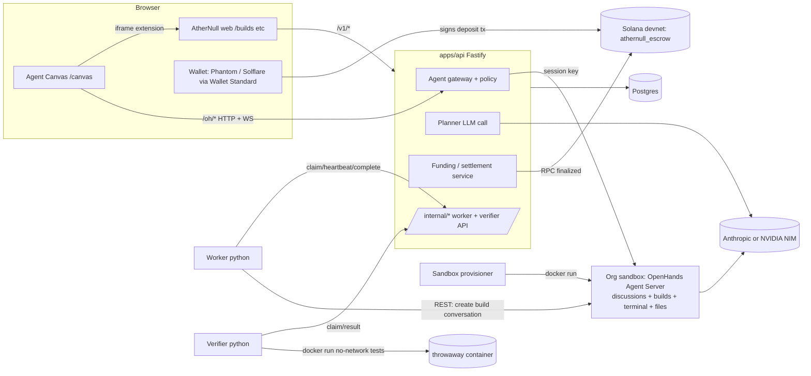
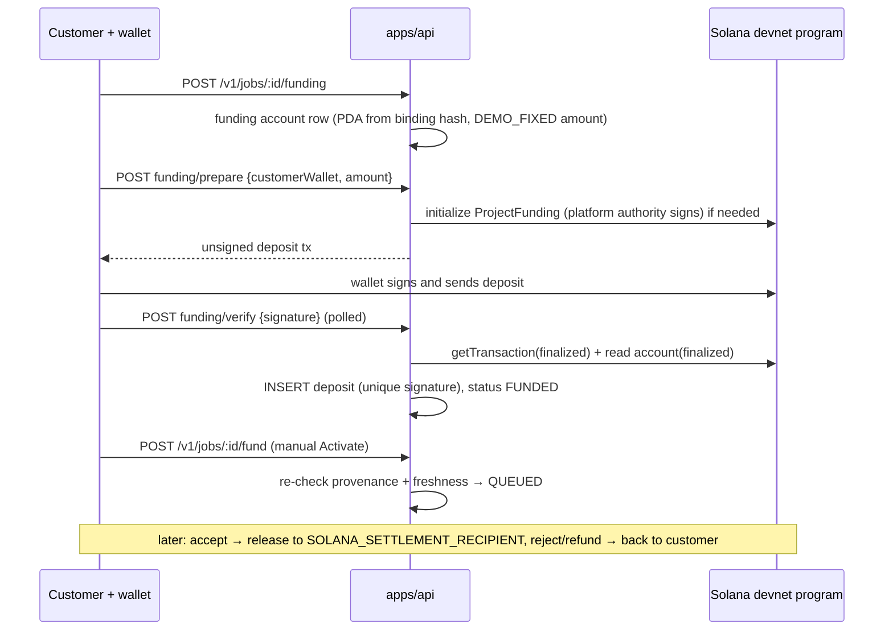

# AtherNull: Current Architecture Audit

Date: 2026-10-12. Branch `feat/openhands-canvas-and-devnet-settlement` (working tree, including uncommitted ADR-0019 hosted-repository work and the Apps lock-down in `agent-gateway/policy.ts`).

Method: read-only static inspection of the source, migrations and configuration. I did not run anything against a database, sandbox or chain, made no payments, and changed no code for this audit. Secret values were not read; only variable names are reported.

Confidence labels: **Confirmed** = read in the code path. **Likely** = follows from the code, but depends on runtime or deployment I could not observe. **Unknown** = cannot be determined from the repository.

---

## 1. Executive Summary

AtherNull is a pnpm monorepo with five parts:
- a Next.js app (`apps/web`) that holds the AtherNull UI, including the Builds page
- a Fastify API (`apps/api`)
- a patched, pinned build of the OpenHands Agent Canvas (`apps/canvas`) that is the chat workspace
- a Python coding-agent worker (`workers/coding-agent`)
- a Python independent verifier (`services/verifier`)

Postgres (Kysely, raw SQL migrations) is the system of record. Each organization gets its own Docker container running an **OpenHands Agent Server**. Chat conversations, terminals, files and builds all live in that container. A Solana Anchor program (`contracts/solana`) holds funding in escrow on **devnet only**.

The real, working path today:

1. **Chat.** The customer chats in the canvas. The gateway replaces every new conversation with a **tool-less "discussion" agent** that can only talk. It cannot plan in a structured way, price, or build.
2. **Plan.** In **AtherNull Builds** (a separate page, framed into the canvas), the customer clicks **Turn into a build**, picks a **repository**, and clicks **Draft plan**. The API reads the discussion transcript from the sandbox, calls an LLM planner, and stores a **structured, versioned estimate**.
3. **Approve, budget, prepare.** The customer approves the plan, authorizes a budget (always typed in by hand, because pricing is unconfigured and every plan is `UNPRICED`), and prepares a build. This creates a `tasks` row in `AWAITING_FUNDING`.
4. **Fund.** The customer connects a Wallet Standard wallet (Phantom and Solflare are detected automatically) and deposits **devnet SOL** into a per-build escrow account. The amount is a **fixed demo amount** (default 0.05 SOL), unrelated to the plan or budget. The API verifies deposits at **finalized** commitment.
5. **Activate.** The customer clicks **Activate Build**. The task becomes `QUEUED`. This is manual, not automatic.
6. **Build.** The worker claims the task and runs the agent as a **new conversation** in the org sandbox (terminal + file editor). It captures the result as a patch, or as a commit when hosted repositories are used, and the task goes to `VERIFYING`.
7. **Verify.** The independent verifier runs the project's tests offline in a throwaway container and reports PASS or FAIL.
8. **Accept or reject.** The customer accepts, which pays the platform on-chain, or rejects, which refunds the customer on-chain.

Compared with the target chat-native USDC workflow, about half the backbone already exists and is good quality: structured plans, versioning, approval, budget authorization, escrow with finalized verification, an execution engine and independent verification. What's missing is everything **chat-native**, all **USDC/SPL** support, **pricing and invoices**, **automatic activation**, and **keeping the build in the original conversation**. There are also real security issues to fix before any public hosting (section 14).

---

## 2. Repository Structure and Technology Stack

### 2.1 Relevant tree

```
AtherNull/
├── package.json, pnpm-workspace.yaml        pnpm 9 monorepo, Node ≥ 20
├── scripts/dev.mjs                           one-command local stack (Postgres, migrations, canvas build, API, web, ingress, worker)
├── infrastructure/
│   ├── docker-compose.yml                    LOCAL ONLY: postgres:16 (host port 5433) + redis:7 (unused by code)
│   └── ingress/dev-ingress.mjs               single origin :8080 → web / api / canvas
├── apps/
│   ├── api/  (Fastify 5, TypeScript, Kysely)
│   │   ├── src/app.ts                        route registration
│   │   ├── src/auth.ts, session.ts           Better Auth (email+password, magic link, organization plugin)
│   │   ├── src/planner.ts                    LLM planner (Anthropic or NVIDIA NIM)
│   │   ├── src/pricing/{engine,rates}.ts     deterministic pricing; RATE_CONFIG = null
│   │   ├── src/agent-gateway/                policy.ts, discussions.ts, org-server.ts
│   │   ├── src/routes/                       19 route modules (section 11)
│   │   ├── src/solana/                       funding-service, settlement-service, provider, config, deposit-parse
│   │   ├── src/repos/                        (uncommitted) ADR-0019 hosted bare git repos
│   │   ├── src/realtime/                     relay + browser realtime registries
│   │   ├── src/sandbox/provision.ts          per-org Docker Agent Server provisioning
│   │   └── scripts/sandbox-provisioner.ts    polls agent_sandbox_requests
│   ├── web/  (Next.js, React Query, Tailwind/Radix)
│   │   ├── app/(app)/builds/page.tsx         Builds page (framed into the canvas)
│   │   ├── components/builds/                builds-home.tsx, start-build-dialog.tsx
│   │   ├── components/canvas/                agent-canvas.tsx (build side panel), lifecycle-steps.tsx
│   │   ├── components/projects/project-funding-panel.tsx   wallet + deposit + Activate Build
│   │   └── lib/api/{live,mock}.ts            live = /v1/*; mock = in-memory "Create New" workspace
│   └── canvas/                               OpenHands Agent Canvas, pinned (UPSTREAM.json) + patches/0002–0005
│       └── extension/athernull/              "AtherNull Builds" canvas extension (iframe to /builds)
├── packages/
│   ├── database/  schema.ts + migrations/0001–0020
│   ├── contracts/ zod schemas + task FSM (tasks.ts)
│   ├── model-router/ cost/complexity tier choice
│   └── solana-client/ PDA derivation, binding hash, instructions, IDL
├── workers/coding-agent/ (Python, openhands-sdk)  worker.py, org_sandbox_adapter.py, agent_server_adapter.py
├── services/verifier/ (Python)                    service.py, checks.py
└── contracts/solana/ (Anchor, Rust)               programs/athernull_escrow (fund / release / refund / timeout_refund / project_funding)
```

### 2.2 Stack per concern

| Concern | Implementation | Evidence |
|---|---|---|
| Frontend (product) | Next.js App Router, React Query, Radix UI | `apps/web/app`, `apps/web/lib/hooks/*` |
| Frontend (chat workspace) | OpenHands Agent Canvas (React Router, Vite), pinned commit `380fd839`, v1.20.0, + 4 patches | `apps/canvas/UPSTREAM.json`, `apps/canvas/patches/` |
| Backend | Fastify 5 + `@fastify/websocket`, zod validation | `apps/api/src/app.ts` |
| Auth | Better Auth: email/password, magic link, HaveIBeenPwned, organization plugin; a personal org is auto-created per user (the user is **owner**) | `apps/api/src/auth.ts:138-171` |
| Authorization | `requireOrgSession` (active org) + `requirePrivilegedRole` (owner/admin) | `apps/api/src/session.ts` |
| Database | Postgres 16, Kysely query builder, hand-written SQL migrations | `packages/database` |
| Caching / state | React Query on the client; no server cache; Redis is provisioned but **not used by any code** (Confirmed by search) | `infrastructure/docker-compose.yml` |
| Jobs / queues | **Postgres as the queue**: `FOR UPDATE SKIP LOCKED` claim with leases; verifier uses the same lease pattern | `routes/internal.ts:50`, `routes/verification.ts:154` |
| Realtime | WebSockets: worker→API relay `/internal/relay/:executionId`; browser `/v1/realtime/executions/:id`; canvas sockets proxied at `/oh/sockets/*` | `routes/relay.ts`, `routes/realtime-gateway.ts`, `routes/agent-gateway.ts` |
| AI | Planner: Anthropic `claude-sonnet-5` or NVIDIA NIM `nemotron-3-super-120b-a12b`. Discussion and build agents: OpenHands Agent Server with NIM by default | `planner.ts:61,236,295`; `discussions.ts:33`; `provision.ts` |
| Blockchain | Solana devnet; Anchor escrow program; `@solana/web3.js`; Helius RPC (named) | `apps/api/src/solana/*`, `contracts/solana` |
| Wallet | `@solana/wallet-adapter-react` with Wallet Standard auto-detection | `project-funding-panel.tsx:373` |
| Deployment | Dev: `scripts/dev.mjs`. `apps/web/Dockerfile` only; no API/worker Dockerfiles; production topology (Coolify is mentioned) **not in the repository** | `infrastructure/README.md` |
| CI | GitHub Actions: pnpm typecheck/build/test; ruff for Python | `.github/workflows/ci.yml` |

---

## 3. Existing System Architecture

- **One browser origin** (dev: `:8080` via `dev-ingress.mjs`). `/canvas/**` is the static canvas build, `/oh/**` is the API agent gateway, `/v1/**` and `/api/auth/**` are the API, and everything else is the Next.js app.
- **The canvas talks only to `/oh/*`.** The gateway authenticates the Better Auth cookie, checks Origin on mutations, classifies the request (`policy.ts`), and proxies to the org's sandbox with the sandbox key injected server-side (`routes/agent-gateway.ts:81-132`). The browser never sees the sandbox key. **Confirmed.**
- **Each org sandbox** is a Docker container `athernull-sandbox-<org8>` from `ghcr.io/openhands/agent-server:latest-python`. It is published on `127.0.0.1:<random>`, has a named volume on `/workspace`, and has `--restart unless-stopped` (`provision.ts:109`). **Confirmed.**
- **The Builds page** is the Next.js `/builds` route. The canvas extension `AtherNull Builds` frames it in an iframe with `?embed=canvas` (`apps/canvas/extension/athernull/extension.js`). **Confirmed.**
- **The worker** polls `/internal/executions/claim` using `INTERNAL_API_TOKEN`. With `EXECUTION_ADAPTER=org_sandbox`, it runs the build on the org's sandbox through REST (`org_sandbox_adapter.py:354`). **Confirmed.**
- **The verifier** polls `/internal/verifications/claim` using `VERIFIER_API_TOKEN` and runs tests in `docker run` with no network (`service.py:127`). **Confirmed.**

---

## 4. Conversation and AI Agent Flow

### 4.1 What happens when a customer sends a message

1. **Creating a conversation.** The canvas sends `POST /oh/api/conversations`.
   - `classifyGatewayRequest` returns `discuss` (`policy.ts`).
   - `startDiscussionUpstream` (`agent-gateway.ts:136`) **throws away the browser's body**, except the opening text, which it caps at 8,000 characters (`discussions.ts:40`).
   - `startDiscussion` (`discussions.ts:81`) enforces **30 discussions per org per day**, then inserts a `discussion_conversations` row.
   - The gateway then POSTs a request it built itself to the sandbox (`buildDiscussionRequest`, `discussions.ts:49`) and sets the title from the first line of the opening message.
2. **Storage.** The **messages themselves live only in the org's Agent Server** (the sandbox volume). Postgres stores only `discussion_conversations` (id, org, creator, `message_count`, timestamps, `planned_lineage_id`). There is **no messages table**. **Confirmed.**
3. **Processing each message.** A chat message is either `POST /oh/api/conversations/:id/events` or a frame on the events WebSocket.
   - It is classified as `agent` work, then `authorizeConversationWork` runs (`agent-gateway.ts:72`).
   - If the conversation is one of this org's discussions, `admitDiscussionMessage` increments `message_count`, capped at **40** (`discussions.ts:14,110`). Any org member can do this.
   - Otherwise it requires owner/admin **and** a `tasks.status = 'RUNNING'` execution bound to that conversation (`assertFundedRunningConversation`, `agent-gateway.ts:54`). If not, the gateway returns **402**.
4. **Prompt construction (discussion).**
   - The `DISCUSSION_INSTRUCTIONS` system suffix gives the agent an "AtherNull Agent" identity, says it has no tools, tells it to scope deliverables and acceptance criteria, then tells the customer to open AtherNull Builds and choose "Turn into a build" (`discussions.ts:19-27`).
   - Skills are not loaded, `tools: []`, `mcp_config: {}`, `max_iterations: 6`.
5. **Model.** `DISCUSSION_LLM_MODEL`, defaulting to `nvidia_nim/nvidia/nemotron-3-super-120b-a12b`, with the platform key `NVIDIA_NIM_API_KEY` (`discussions.ts:29-36`).
6. **Tools.** The discussion agent has none. The build agent gets `terminal`, `file_editor` and `task_tracker`, plus workspace MCP and skills (`org_sandbox_adapter.py:65,386`).
7. **Deciding whether a request is a software project.** **No classifier exists.** Every conversation started from the canvas becomes a discussion. Whether it becomes a build is decided only by the human clicking "Turn into a build". **Confirmed.**
8. **Agent modes and permissions:**
   - **discussion:** chat only, any member.
   - **build:** full tools, runs only while the task is `RUNNING`, steerable by owner/admin.
   - **control:** owner/admin can configure settings, skills, MCP, terminal and files.
   - The planner LLM in the API is a fourth, separate "agent" that only returns JSON.
9. **Streaming.** The OpenHands events WebSocket is proxied frame by frame (`bridge`, `agent-gateway.ts:210`). The browser's auth frame is dropped and the real key is used upstream.
10. **Persistence across refresh.** Yes. Conversations persist in the sandbox volume, and the canvas re-reads them.
11. **Links to users and projects.** A discussion is linked to an **org** and its **creator** only. It has **no project link**. It gains a link to a plan only after "Turn into a build" (`planned_lineage_id`). **Confirmed.**

### 4.2 Can the chat agent execute code?

The discussion agent cannot. Code runs only in the separate build conversation the worker creates after funding and activation. The gateway enforces this server-side. **Confirmed.**

---

## 5. Planning and Approval Logic

| Question | Finding | Evidence | Confidence |
|---|---|---|---|
| Structured planning engine? | Yes. LLM → JSON validated by `PlannerOutputSchema`: goal, scope in/out, deliverables, implementation plan, assumptions, acceptance criteria, infrastructure, risks, resourceEstimate. One retry with a repair instruction. | `planner.ts:92-117,370`; `packages/contracts/src/estimates.ts` | Confirmed |
| Chat text or records? | Persistent records in `project_estimates`. The discussion's own "plan" is only chat text. | `routes/estimates.ts:177-197` | Confirmed |
| Versions / revisions | Yes. `lineage_id` + `version`; revise supersedes the head inside a row-locked transaction; unique `(lineage_id, version)`; one APPROVED per lineage (unique index). | `estimates.ts:282-387`; `0008_project_estimates.sql:50,95` | Confirmed |
| Requirements / acceptance criteria storage | In `planner_output` JSONB; copied into `tasks.requirements` (= goal) and `tasks.acceptance_criteria` when the build is prepared. | `task-provenance.ts` insert | Confirmed |
| Cost / effort estimation | The LLM gives effort only (hours, tokens, tier). The price comes from `priceEstimate()`, but **`RATE_CONFIG = null`**, so **every estimate is `UNPRICED`**. | `pricing/rates.ts:148`; `pricing/engine.ts:45` | Confirmed |
| Where the price comes from | Deterministic code by design. In practice there's no price; the customer **types the budget in by hand** (`USER_SET`). | `budget-authorizations.ts`; `lifecycle-steps.tsx:195-211` | Confirmed |
| Approve / reject | Approve: `POST …/estimates/:id/approve` (owner/admin, idempotent). **There is no reject endpoint.** "Reject" in practice means revising, or simply not approving. | `estimates.ts:393` | Confirmed |
| Approvals persisted | Yes: `approved_by`, `approved_at`, and DB checks pairing them. | `0008_project_estimates.sql:60-66` | Confirmed |
| Approving an old plan | Refused. Only `READY_FOR_REVIEW` can be approved; a superseded version returns 409 pointing to the head. | `estimates.ts:403-438` | Confirmed |
| What makes a plan buildable | Estimate `APPROVED` → an `ACTIVE` budget authorization → `POST /v1/projects/:id/tasks/from-budget-authorization` (owner/admin) creates a task in `AWAITING_FUNDING` and marks the authorization `CONSUMED`. | `task-provenance.ts` | Confirmed |

**Partially implemented or defective:**
- **Revising loses context.** `revise` replans from the **new message only**, not the previous plan or the discussion (`estimates.ts:299`). "Add more: also do X" produces a plan about X alone. **Confirmed (bug).**
- The `DRAFT` status exists but is never produced.
- `Prepare build` silently uses the **first** agent profile (`lifecycle-steps.tsx:242`) and asks for a free-text revision (default `main`).

---

## 6. Builds Dashboard and Repository Dependencies

### 6.1 The flow end to end

```
BuildsHome (apps/web/components/builds/builds-home.tsx)
  useDiscussions()  → GET /v1/discussions  → listDiscussions(org)        (discussions.ts:197)
  useBuilds()       → GET /v1/builds       → tasks + draft lineages     (routes/builds.ts:23)
  readyDiscussions = discussions.filter(d => !d.plannedLineageId)       (builds-home.tsx:78)
  "Turn into a build" → StartBuildDialog(discussion)
StartBuildDialog (start-build-dialog.tsx)
  useRepoProjects() → GET /v1/projects
  ready = (selected project OR typed repo URL) AND (discussion OR prompt)   (line 39)
  submit():                                                                (lines 41-57)
    if "+ Another repository…" → POST /v1/projects {permittedRepository}
    POST /v1/projects/:projectId/estimates {discussionId}
      → discussionPlannerPrompt: reads transcript from sandbox (events/search)
      → generatePlannerOutput → priceEstimate → INSERT project_estimates (READY_FOR_REVIEW)
      → markDiscussionPlanned (sets planned_lineage_id)
    onPlanned → open side panel ?project=&lineage= → AgentCanvas (approve → budget → prepare → fund → activate → review)
```

### 6.2 Answers

**A. Why is Draft plan disabled until a repository is selected?** `ready` requires either an existing project or a non-empty new repository URL (`start-build-dialog.tsx:39`). It does this because the API attaches plans to a **project**, and a project in the current data model **is** a repository: `projects.permitted_repository` is `NOT NULL`. **Confirmed.**

**B. Is this enforced by the backend or only the UI?** Both, indirectly.
- `POST /v1/projects/:projectId/estimates` requires a project owned by the org (`estimates.ts:147`).
- `POST /v1/projects` requires `permittedRepository: z.string().min(1)` (`routes/projects.ts`). The value is **not validated as a URL**; any non-empty string is accepted.
- The repository only actually matters at **dispatch time**. `pinBaseCommit` imports it (https only in production; `repos/projects.ts:16-55`), or the worker clones it directly.
- ADR-0019 adds `createRepo()` for brand-new hosted projects (`repos/repos.ts:72`), but **no route calls it yet**. So "new project with no repository" is designed but not reachable. **Confirmed.**

**C. What happens after Draft plan is clicked?**
1. An optional project insert.
2. The transcript is read from the sandbox.
3. One or two LLM planner calls (each with a 30 s timeout).
4. An estimate is inserted.
5. The discussion is marked as planned.
6. The UI opens the build side panel on that lineage.

**D. What does it create?** A `projects` row (if new) and a `project_estimates` row, and it updates `discussion_conversations`. It **invokes the planner LLM**. It does **not** create a git repository, a task, an execution, a payment or a sandbox conversation. **Confirmed.** (The estimates route statically forbids touching tasks or executions; `estimates.ts:21-30`.)

**E. When does a conversation appear in Ready to build?** When there's a `discussion_conversations` row for the active org with `planned_lineage_id IS NULL`, and it's among the 20 most recent by `last_message_at` (`discussions.ts:203`; `builds-home.tsx:78`). Only gateway-started conversations get a row; build conversations never appear here. **Confirmed.**

**F. Why do deleted conversations still appear?**
- Deleting a conversation in the canvas sends `DELETE /oh/api/conversations/:id`. That is classified as `control` (`policy.ts:107`) and **proxied straight to the sandbox** (`agent-gateway.ts:101-132`).
- Nothing deletes or archives the `discussion_conversations` row. The only `deleteFrom("discussion_conversations")` call is the rollback in `forgetDiscussion` (`discussions.ts:103`), which runs only when creation fails.
- `listDiscussions` then lists the orphaned row. Its title lookup against the sandbox fails, so the title is `null` and it shows as **"Untitled discussion"** (`discussions.ts:212-222`; `builds-home.tsx:114`).
- Clicking "Turn into a build" on it fails at `fetchTranscript` with 502 ("Could not read the discussion from the agent sandbox").
- **Confirmed** (root cause in code; I did not reproduce it at runtime).

**G. Separate persistence or caching?** Yes, three separate stores:
- Conversation content: the sandbox Agent Server.
- Discussion index: `discussion_conversations` in Postgres.
- Builds: `project_estimates` and `tasks` in Postgres.

The client has separate React Query keys: `["discussions"]` (no polling), `["builds"]` (polls every 5 s when active, otherwise every 15 s), and `["repo-projects"]`. Nothing keeps the sandbox and Postgres in sync. **Confirmed.**

**H. Is a build permanently linked to its conversation?** Weakly, and only in one direction:
- `discussion_conversations.planned_lineage_id` is a nullable uuid with **no foreign key** (`0019_discussion_planned_lineage.sql`).
- The estimate keeps a **snapshot** of the transcript in `source_prompt`.
- The task links to the estimate (`source_estimate_id`). Executions link to the **separate build conversation** (`executions.conversation_id`).
- There is no `discussion_id` on tasks or estimates. **Confirmed.**

**I. Can the whole build process start inside the original chat?** **No.**
- The discussion agent has no tools and cannot create plans, approvals or payments. It is told to send the customer to Builds.
- The build runs in a **different** conversation.
- The canvas home composer can pass `?prompt=` into the Builds iframe (`extension.js`), but that is a hand-off, not an in-chat flow. **Confirmed.**

**J. Functional versus UI-only**

| Element | Status |
|---|---|
| Ready to build list, Turn into a build, Draft plan | Functional (live API, LLM, DB) |
| Repository selector | Functional, but limited to a free-text https URL or an existing project; no GitHub integration or picker |
| Your builds list | Functional (read-only union of tasks and draft lineages) |
| Approve / budget / prepare / fund / activate / accept / reject / refund | Functional against the live API and devnet |
| Price on the plan card | UI exists but never shows, because estimates are always `UNPRICED` |
| `projects/[id]/workspace` "Create New" greenfield flow | **Mock only.** `lib/api/mock.ts` is in-memory (`lib/api/index.ts` comment); `workspace/page.tsx:24` imports it |

---

## 7. Database Models and Relationships

Source: `packages/database/src/schema.ts`, `migrations/0001–0020`. Better Auth tables (`user`, `session`, `organization`, `member`, …) come from `0001`.

| Entity | Exists? | Key fields / constraints |
|---|---|---|
| Users / orgs / members | Yes (Better Auth) | Roles: owner/admin/member; personal org auto-created |
| Conversations | **Index only**: `discussion_conversations` | PK `conversation_id` (text); FK org and user; `message_count ≥ 0`; index `(organization_id, created_at desc)`; `planned_lineage_id` (no FK) |
| Messages | **No** (stored in the sandbox) | n/a |
| Projects | `projects` | `permitted_repository NOT NULL`, `revision`, `scope`, `owner_user_id`, `repo_kind ('hosted'\|'github')` (0020); unique `(id, organization_id)` |
| Plans | `project_estimates` | lineage/version unique; status check (DRAFT, READY_FOR_REVIEW, APPROVED, SUPERSEDED); one APPROVED per lineage; pricing columns; composite FK to project+org |
| Approvals | Columns on `project_estimates` | `approved_by`/`approved_at` paired by a check constraint |
| Budget | `project_budget_authorizations` | amount `>0 and ≤ 1e11`; source (`ESTIMATE_PROPOSED_CAP`/`USER_SET`); status ACTIVE/SUPERSEDED (CONSUMED is also used); one ACTIVE per estimate |
| Invoices | **No** | n/a |
| Payments | `project_funding_accounts`, `project_funding_deposits`, `project_funding_settlements`; legacy `payment_intents` | One funding account per task and per authorization; unique binding hash and PDA; trigger makes identity, `customer_wallet` and `init_signature` immutable and prevents confirmed amounts from decreasing; deposits unique by `signature` |
| Wallets | Column only: `project_funding_accounts.customer_wallet` | Bound on first prepare and immutable after; no wallet table and no wallet auth |
| Builds | `tasks` | Status as text (FSM in `contracts/tasks.ts`); `version` for optimistic locking; `source_estimate_id`, `source_budget_authorization_id`; `base_commit`/`result_commit`/`merged_commit` (0020, immutability trigger) |
| Build jobs | `executions` | Lease owner/expiry, `attempt_id`, `conversation_id`, routing fields, `failure_reason`; unique `(task_id, attempt_id)` |
| Repositories | Bare git repos on disk at `REPOS_ROOT/<org>/<project>.git` (0020); no table | `apps/api/src/repos/*` (uncommitted) |
| Build events | `execution_events`, `usage_events`, `task_usage_policies`, `task_usage_pauses` | Usage unique by `(execution_id, provider_request_id)` |
| Artifacts | `execution_patches` (patch text, sha256, stats, verify lease, `result_commit`); `artifacts` table exists (0002) but is unused | |
| Verification | `verification_runs` | outcome, tests, evidence, artifact hash |
| Sandboxes | `org_agent_servers` (base URL + **plaintext** `session_api_key`), `agent_sandbox_requests` | |
| Audit log | `audit_events` table exists (0002) but **nothing writes to it** | Confirmed by search |

---

## 8. Deletion and Data Lifecycle

No API route deletes any platform record. There are no `ON DELETE` cascades; foreign keys are restrictive. The only deletion is conversation deletion inside the sandbox, done through the canvas. **Confirmed.**

| Scenario | What happens | Confidence |
|---|---|---|
| User deletes a conversation (no plan) | Sandbox deletes it. The Postgres row stays and appears in Ready to build as "Untitled discussion". Turn into a build then fails (502). It still counts toward the 30/day cap. | Confirmed |
| Conversation has a draft plan | Sandbox deletes the chat. The estimate stays (with its transcript snapshot) and still appears under Your builds as a draft. The discussion row is hidden from Ready because `planned_lineage_id` is set. | Confirmed |
| Conversation has a pending build (`AWAITING_FUNDING`) | The task is unaffected; it isn't linked to the conversation. | Confirmed |
| Conversation has a funded / running build | Deleting the **discussion** doesn't affect it. Deleting the **build** conversation (owner/admin can) removes it from under the worker. The worker's polling should fail, leading to `FAILED` and then a retry with a new conversation (up to 3 attempts). | Likely |
| Build fails | `complete(failure)` → `FAILED`, then back to `QUEUED` until `MAX_EXECUTION_ATTEMPTS = 3` (`internal.ts`); after that it stays `FAILED`. Owner can `POST /refund` for an on-chain refund. | Confirmed |
| Customer returns to an old conversation | Chat works until the 40-message cap. If it was already planned, new messages **don't** update the plan, and it no longer shows in Ready. | Confirmed |

**Orphan and inconsistency risks:**
- Stale discussion rows.
- Duplicate plans: there's no check that `planned_lineage_id IS NULL` before planning, so double-clicking or two tabs create two lineages.
- `planned_lineage_id` has no foreign key.
- Sandbox recreation (`provision.ts` removes and re-runs the container when it isn't running) keeps the named volume, so conversations survive. A new volume name would orphan every row.

---

## 9. Wallet and Payment Capabilities

| # | Question | Answer | Evidence | Confidence |
|---|---|---|---|---|
| 1 | Wallet connection | **Yes.** Wallet Standard auto-detection (`WalletProvider wallets={[]}`), so Phantom and Solflare work if installed and set to devnet. | `project-funding-panel.tsx:68,373` | Confirmed |
| 2 | Wallet authenticated | **No sign-in or message signature.** The first `funding/prepare` call binds the wallet (immutable). The on-chain account checks that the customer equals the bound wallet. | `funding-service.ts:203-249,181` | Confirmed |
| 3 | USDC | **No.** `asset_type: "DEVNET_SOL"`, lamports only. No SPL token, mint or token-account code. | `funding-service.ts:150`; search | Confirmed |
| 4 | Payment destination | The per-build escrow PDA comes from the program id and a binding hash (org, project, task, authorization). The settlement recipient comes from `SOLANA_SETTLEMENT_RECIPIENT`; the authority from `SOLANA_AUTHORITY_KEYPAIR`/`SOLANA_AUTHORITY_PUBKEY`. Server-side config; nothing comes from the client. | `funding-service.ts:134-157` | Confirmed |
| 5 | Invoices | **No.** | Schema | Confirmed |
| 6 | Independent on-chain verification | **Yes.** `getTransaction` at **finalized**; deposit parsing; account owner, discriminator, binding, customer, authority and required-amount checks; ledger sum ≤ on-chain deposited amount; history scan for missed deposits. | `funding-service.ts:167-190,416-564` | Confirmed |
| 7 | Payment triggers the build automatically | **No.** The customer must click **Activate Build** (`POST /v1/jobs/:id/fund`), which re-checks everything, including that verification is less than 5 minutes old. | `project-funding-panel.tsx:193,353`; `jobs.ts:325` | Confirmed |
| 8 | Manual "mark as paid" | No mark-as-paid for **funding**. But: (a) `POST /v1/jobs/:id/verify` lets an owner record verification **PASS/FAIL by hand**, and (b) accept/refund on a task with **no deposit** writes a `payment_intents` row with `chain: "stub"`, `status: "CONFIRMED"`. | `jobs.ts:444`; `jobs.ts:135` | Confirmed |
| 9 | Duplicate transaction protection | **Yes.** Unique deposit `signature`; one funding account per task and per authorization; guarded status updates. | `0013_project_funding.sql:93-96,154` | Confirmed |
| 10 | Survives restarts | **Yes.** All state is in Postgres, and the chain is re-read on demand. No in-memory payment state. | | Confirmed |

**Amount mismatch (Confirmed).** The required deposit is `requirement_source: "DEMO_FIXED"`, `SOLANA_DEMO_REQUIRED_LAMPORTS` (default **50,000,000 lamports = 0.05 SOL**; `config.ts:22`, `funding-service.ts:155-156`). The budget the customer authorizes (in fiat minor units, default currency "USD" in the UI) **does not affect what they pay**.

**Network policy.** `assertDevnetNetworkPolicy` fails closed unless `SOLANA_NETWORK` is exactly `devnet`. Mainnet is impossible without code changes.

**Variable names only:** `SOLANA_NETWORK`, `SOLANA_RPC_PROVIDER`, `SOLANA_RPC_URL`, `SOLANA_FUNDING_PROGRAM_ID`, `SOLANA_AUTHORITY_KEYPAIR`, `SOLANA_AUTHORITY_PUBKEY`, `SOLANA_DEMO_REQUIRED_LAMPORTS`, `SOLANA_SETTLEMENT_RECIPIENT`.

---

## 10. Build Execution and Deployment

| Aspect | Implementation | Confidence |
|---|---|---|
| Orchestration entry | `POST /v1/jobs/:id/fund` → `QUEUED`; worker `POST /internal/executions/claim` | Confirmed |
| Scheduling | Postgres `FOR UPDATE SKIP LOCKED`; lease `EXECUTION_LEASE_SECONDS` (300 s) renewed by heartbeat; expired leases are reclaimed | Confirmed |
| Coding agent | OpenHands Agent Server conversation; tools `terminal`, `file_editor`, `task_tracker`, plus workspace skills and MCP; `max_iterations` 100; 30-minute cap (`ORG_SANDBOX_MAX_RUN_SECONDS`) | Confirmed |
| Repository | Hosted bare repo bundle (ADR-0019, uncommitted) when importable; otherwise `git clone` of `permitted_repository` inside the sandbox; work in `/workspace/builds/<taskId>` | Confirmed |
| Sandbox | **The org's long-lived sandbox**, not a per-build container. Every build and discussion of an org shares one container and volume. No CPU or memory limits; default Docker network with outbound internet. | Confirmed (`provision.ts:109`) |
| Dependencies / commands | Run by the agent through the terminal tool; no platform-managed install step | Confirmed |
| Tests | Independent verifier: fresh checkout + patch or commit; detects `npm test` or `pytest`; installs with network, then runs tests with **no network**, in `docker run --rm`. PASS → `AWAITING_ACCEPTANCE`, FAIL → `FAILED`. | Confirmed |
| Deployment of the customer's app | **None.** No deploy integration exists. | Confirmed |
| Progress events | Worker forwards Agent Server events and usage → `execution_events`/`usage_events`; browser realtime WS; the canvas shows the build conversation live | Confirmed |
| Retries | `FAILED → QUEUED` up to 3 attempts (not for `USAGE_ENFORCEMENT_FAILED`) | Confirmed |
| Cancellation | FSM allows `CANCELLED` from pre-run states, but **no cancel endpoint exists**. Realtime control can pause or interrupt a running conversation. | Confirmed |
| Artifacts / delivery | Patch (`GET /v1/jobs/:id/patch`); with ADR-0019, a commit on `builds/<taskId>`, merged into `main` on accept. Download and versions are planned (ADR-0019 steps 2–4). | Confirmed / partly planned |

**Isolation.**
- Per org: yes, a separate container and key.
- Per project or per build: **no**. Builds of different projects in the same org share a sandbox and filesystem.

**Limits on unattended execution:**
- Manual Activate.
- Manual Accept.
- A worker and verifier process must be running.
- Each org sandbox must be provisioned by a separate provisioner process.
- No per-build resource caps.

---

## 11. API and Event Inventory

Auth key: **S** = session + org; **P** = session + owner/admin; **I** = `INTERNAL_API_TOKEN`; **V** = `VERIFIER_API_TOKEN`.

| Method | Route | Handler file | Auth | Actual behavior |
|---|---|---|---|---|
| GET | /health | app.ts | none | liveness |
| ALL | /api/auth/* | app.ts → Better Auth | n/a | sign-up/in, magic link, orgs |
| GET/POST | /v1/projects | projects.ts | S | list / create a repository project (no URL validation) |
| GET | /v1/agent-profiles | agent-profiles.ts | S | list profiles |
| GET | /v1/discussions | discussions.ts | S | discussion index + live titles from the sandbox (one sandbox call per row) |
| GET | /v1/builds | builds.ts | S | union of tasks (≤ 50) and unbuilt draft lineages |
| POST | /v1/projects/:p/estimates | estimates.ts | S | plan from a prompt or `discussionId` (LLM) |
| GET | /v1/projects/:p/estimates[/:e] | estimates.ts | S | read plans |
| POST | /v1/projects/:p/estimates/:e/revise | estimates.ts | S | new version (**from the new prompt only**) |
| POST | /v1/projects/:p/estimates/:e/approve | estimates.ts | P | approve an exact version (idempotent) |
| POST | /v1/projects/:p/estimates/:e/budget-authorization | budget-authorizations.ts | P | ACTIVE authorization (proposed cap or user-set) |
| GET | …/budget-authorizations (estimate / project) | budget-authorizations.ts | S | list |
| POST | /v1/projects/:p/tasks/from-budget-authorization | task-provenance.ts | P | create task `AWAITING_FUNDING`, consume the authorization |
| POST | /v1/jobs | jobs.ts | P | legacy; 403 unless `ALLOW_LEGACY_JOB_CREATION=true` |
| POST | /v1/jobs/estimate | jobs.ts | S | routing tier estimate |
| GET/POST | /v1/jobs/:id/funding | project-funding.ts | S / P | view / create funding account |
| POST | /v1/jobs/:id/funding/prepare | project-funding.ts | P | bind wallet; build the unsigned deposit transaction |
| POST | /v1/jobs/:id/funding/verify | project-funding.ts | P | credit a finalized deposit / refresh from chain |
| POST | /v1/jobs/:id/fund | jobs.ts | P | **Activate**: `AWAITING_FUNDING → QUEUED` after the funding gate |
| POST | /v1/jobs/:id/verify | jobs.ts | P | **manual** PASS/FAIL (bypasses the independent verifier) |
| POST | /v1/jobs/:id/accept | jobs.ts | P | `AWAITING_ACCEPTANCE → SETTLING` + on-chain release |
| POST | /v1/jobs/:id/reject | jobs.ts | P | `AWAITING_ACCEPTANCE → REFUNDING` + on-chain refund |
| POST | /v1/jobs/:id/refund | jobs.ts | P | `FAILED`/`CANCELLED → REFUNDING` |
| POST | /v1/jobs/:id/settlement/verify | jobs.ts | S | move settlement or refund to finalized |
| GET | /v1/jobs, /v1/jobs/:id, …/executions/:x/events, /v1/jobs/:id/patch | jobs.ts, verification.ts | S | read |
| * | /v1/projects/:p/tasks/:t/usage-policy, …/usage-pauses, …/usage-limit/resume | usage-policies.ts | S / P | soft token limits, pause/resume |
| GET | /v1/usage/summary | usage.ts | S | usage totals |
| GET/POST | /v1/agent-sandbox | agent-sandbox.ts | S | sandbox status / request provisioning |
| ALL | /oh/* | agent-gateway.ts | S + policy | proxy to the org sandbox (discuss / agent / control / read / blocked) |
| WS | /oh/sockets/events/:id, /oh/sockets/bash-events | agent-gateway.ts | S (+ P for bash) | proxied canvas sockets |
| WS | /v1/realtime/executions/:id | realtime-gateway.ts | S | live execution view + control |
| GET/PATCH | /api/conversations*, /api/settings, /server_info | openhands-compat.ts | S | legacy read-only compatibility layer (ADR-0006) |
| POST | /internal/executions/claim, /:id/heartbeat, /conversation, /events, /usage, /usage-pause, /usage-resume, /complete | internal.ts | I | worker lifecycle |
| WS | /internal/relay/:executionId | relay.ts | I | worker → API event relay |
| GET/POST | /internal/executions/:id/repo-bundle, /result-bundle | repo-transfer.ts | I | ADR-0019 code transfer |
| POST | /internal/executions/:id/patch | verification.ts | I | captured patch |
| POST | /internal/verifications/claim, /:x/result; GET /:x/bundle | verification.ts, repo-transfer.ts | V | independent verifier |

**Background processes:** the worker (Python), the verifier (Python), and the sandbox provisioner (`apps/api/scripts/sandbox-provisioner.ts`, polls `agent_sandbox_requests`). There is no cron, no job queue library and no webhooks. Payment state advances only when the client calls `funding/verify` or `settlement/verify`.

**Client synchronization:** React Query polling (builds every 5 or 15 s); funding confirmation polling inside `project-funding-panel.tsx`; WebSockets for live build events.

**Local-only state:**
- The selected lineage and project live in the URL.
- The StartBuildDialog choices live in component state (fine).
- The "Create New" workspace is entirely in-memory (mock).

---

## 12. Current Architecture Diagrams

### Diagram A: System architecture (as implemented)



### Diagram B: Conversation lifecycle

```mermaid
sequenceDiagram
  participant U as Customer (canvas)
  participant G as Gateway /oh
  participant DB as Postgres
  participant S as Org Agent Server
  U->>G: POST /api/conversations (opening text)
  G->>DB: daily cap check; INSERT discussion_conversations
  G->>S: POST conversation (tools: [], discussion prompt, max_iterations 6)
  S-->>G: conversation
  G->>S: PATCH title (first line)
  G-->>U: conversation
  loop each message (≤ 40)
    U->>G: events (HTTP or WS frame)
    G->>DB: message_count + 1 (cap)
    G->>S: forward
    S-->>U: streamed agent reply (WS proxy)
  end
  Note over U,S: Messages persist only in S. The agent can only talk and points to Builds.
  U->>G: DELETE conversation
  G->>S: forwarded
  Note over DB: discussion_conversations row NOT removed → shows as "Untitled discussion"
```

### Diagram C: Build lifecycle (last implemented state = SETTLED / REFUNDED)

```mermaid
stateDiagram-v2
  [*] --> Discussion
  Discussion --> EstimateReady: Builds → Turn into a build → pick repo → Draft plan (LLM)
  EstimateReady --> EstimateReady: revise (new version, new prompt only)
  EstimateReady --> Approved: approve (owner/admin)
  Approved --> BudgetActive: authorize budget (manual amount; UNPRICED)
  BudgetActive --> AWAITING_FUNDING: Prepare build (task created)
  AWAITING_FUNDING --> AWAITING_FUNDING: connect wallet, deposit fixed devnet SOL, verify (finalized)
  AWAITING_FUNDING --> QUEUED: Activate Build (manual click)
  QUEUED --> RUNNING: worker claims (new sandbox conversation)
  RUNNING --> VERIFYING: success (patch/commit captured)
  RUNNING --> QUEUED: failure, attempts < 3
  RUNNING --> FAILED: failure, attempts exhausted
  VERIFYING --> AWAITING_ACCEPTANCE: verifier PASS (or manual PASS)
  VERIFYING --> FAILED: verifier FAIL (or manual FAIL)
  AWAITING_ACCEPTANCE --> SETTLING: Accept
  AWAITING_ACCEPTANCE --> REFUNDING: Reject
  FAILED --> REFUNDING: Refund
  SETTLING --> SETTLED: release finalized
  REFUNDING --> REFUNDED: refund finalized
  note right of AWAITING_FUNDING: No deployment step exists. No cancel endpoint.
```



### Diagram D: Payment lifecycle (devnet SOL escrow, real)



---

## 13. Bugs and Root-Cause Findings

| # | Bug | Root cause | Evidence | Confidence |
|---|---|---|---|---|
| B1 | Deleted conversations remain in Ready to build ("Untitled discussion") and fail when planned | The gateway proxies DELETE to the sandbox; nothing removes the `discussion_conversations` row | `policy.ts:107`; `agent-gateway.ts:101-132`; `discussions.ts:197-234` | Confirmed |
| B2 | "Add more" or revising a plan drops the original requirements | `revise` sends only `body.prompt` to the planner | `estimates.ts:299` | Confirmed |
| B3 | The same discussion can be turned into several plans | No `planned_lineage_id IS NULL` guard or lock before planning | `estimates.ts:155-199` | Confirmed |
| B4 | The amount paid is unrelated to the plan or budget | `DEMO_FIXED` requirement | `funding-service.ts:155` | Confirmed |
| B5 | Plans never show a price | `RATE_CONFIG = null` | `rates.ts:148` | Confirmed |
| B6 | Repository required even for a new idea | Data model: project = repository; `createRepo` not exposed through any route | `start-build-dialog.tsx:39`; `repos.ts:72` | Confirmed |
| B7 | Ready-to-build list loads slowly with many discussions | One sandbox HTTP call per row for titles | `discussions.ts:211-233` | Confirmed (performance) |
| B8 | Prepare build silently picks the first agent profile | `profiles?.[0]` | `lifecycle-steps.tsx:242` | Confirmed |

---

## 14. Security and Reliability Risks

Observations only; recommendations are in section 18.

| Sev | Finding | Evidence | Confidence |
|---|---|---|---|
| **Critical** | **Org sandboxes are not network-isolated or resource-limited, and owners have a shell.** `docker run` sets no `--network`, `--memory`, `--cpus` or `--pids-limit`. Every customer is an owner, so every customer has a terminal. From the default bridge, a sandbox can reach the Docker host gateway, where dev Postgres is published on all interfaces (`5433:5432`, default credentials in `docker-compose.yml`). That database holds every org's data, including `org_agent_servers.session_api_key`. Exposure in production depends on the deployment, which isn't in the repository. | `provision.ts:109`; `infrastructure/docker-compose.yml:18` | Likely |
| **High** | **The platform LLM key is written into every customer sandbox** (`/api/settings` and the `default` profile). Owners have a terminal and settings access in their own sandbox, so the key can most likely be read. | `provision.ts:122-131` | Likely |
| **High** | **A customer can receive the work and then pay nothing.** The patch (`GET /v1/jobs/:id/patch`) and the live sandbox files are visible before acceptance. The owner can then **Reject** for a full refund, or call **`POST /v1/jobs/:id/verify` with FAIL** and then **Refund**. | `jobs.ts:444,547,567`; `settlement-service.ts:83` | Confirmed |
| **High** | **Manual verification bypasses the independent verifier.** An owner can mark PASS or FAIL themselves. | `jobs.ts:444-505` | Confirmed |
| Medium | Sandbox session keys are stored in plaintext in `org_agent_servers` | schema; `provision.ts` | Confirmed |
| Medium | The sandbox image is unpinned (`latest-python`), unlike the pinned canvas, so behaviour and the API surface can drift | `provision.ts` `IMAGE` | Confirmed |
| Medium | No audit trail: `audit_events` exists but is never written | search | Confirmed |
| Medium | Wallets aren't authenticated. Binding happens on first prepare, and a privileged member could bind a wallet they control (it's limited to their own org's funds) | `funding-service.ts:203` | Confirmed |
| Medium | All builds of an org share one filesystem, so one project's build can read another project's files | `org_sandbox_adapter.py` `BUILDS_ROOT` | Confirmed |
| Medium | Stale discussion rows, duplicate plans, no foreign key from discussion to plan | B1, B3 | Confirmed |
| Medium | Payment and settlement progress only when the client polls. If the customer closes the tab, finalization waits until the next call; no background reconciler | `jobs.ts:581`; funding panel | Confirmed |
| Low | `permitted_repository` isn't validated when a project is created; https-only is enforced later, at import | `projects.ts`; `repos.ts:86` | Confirmed |
| Low | A legacy `payment_intents` row with `chain:"stub"` and `CONFIRMED` is written when accepting or refunding a build with no deposit, which could mislead reporting | `jobs.ts:128-140` | Confirmed |
| Low | Discussion admission scans every discussion of the org on each message (normalizing ids) | `discussions.ts:110-117` | Confirmed |
| Positive | Fail-closed gateway policy; server-built discussion requests; finalized-only crediting; DB immutability triggers; optimistic locking on transitions; provenance chain re-checked at activation; tenant scoping on every query I read; Apps (canvas extensions) cannot be changed from a browser (uncommitted change) | various | Confirmed |

---

## 15. Current vs Intended Architecture Gap Matrix

Target: idea in chat → AI improves the requirements → structured plan in the same chat → Approve / Reject / Add more → itemized invoice → Pay Now → Phantom/Solflare → native USDC on Solana → backend verifies finalized settlement → exactly one build authorized automatically → progress and deliverables in the original conversation.

| Capability | Current State | Evidence | Missing Components | Complexity | Risk |
|---|---|---|---|---|---|
| Idea captured in chat | Done (discussion agent) | `discussions.ts` | Nothing major | Low | Low |
| AI improves requirements | Partial: the prompt asks the agent to scope, but output is free text | `discussions.ts:19-27` | Structured requirement capture | Low–Med | Low |
| Structured plan **in the same chat** | Missing: plans exist only in Builds, and the agent has no tools | `estimates.ts`; `tools: []` | A planning tool or action that the discussion agent (or gateway) can call; a plan-card renderer in the canvas (patch); a link from discussion to lineage | **High** (crosses the canvas/OpenHands boundary) | Med |
| Approve / Reject / Add more in chat | Partial: approve exists (Builds); no reject endpoint; revise loses context | `estimates.ts:282,393` | Reject state; revise with context; chat actions | Med | Low |
| Itemized invoice | Missing: no invoice model, and pricing is unconfigured | `rates.ts:148` | Rate card, line items, `invoices` table, immutable snapshot tied to the plan version | Med | Med (money correctness) |
| Pay Now | Partial: deposit flow exists inside the Builds side panel | `project-funding-panel.tsx` | Chat-embedded payment action | Med | Low |
| Phantom / Solflare | Done (Wallet Standard) | `:373` | Mobile / deep-link handling | Low | Low |
| Native USDC | Missing: SOL lamports only; the escrow program is SOL-based | `asset_type: DEVNET_SOL`; `contracts/solana` | SPL token escrow (program change + audit), mint config, ATA handling, decimal-safe amounts | **High** | **High** (new contract code) |
| Verify finalized settlement | Done for SOL | `funding-service.ts:416-564` | Port to token-account balance and transfer parsing | Med | Med |
| Amount tied to the invoice | Missing (`DEMO_FIXED`) | `funding-service.ts:155` | Requirement from the invoice; FX policy if invoices are in fiat | Med | High |
| Automatically authorize exactly one build | Partial: one task per authorization and one funding account per task are enforced, but activation is a manual click | `jobs.ts:325`; constraints | Server-side reconciler that verifies and activates idempotently | Med | Med |
| Build progress in the original conversation | Missing: the build runs in a new conversation | `org_sandbox_adapter.py:354` | Either run the build in the discussion conversation (switch agent and tools after funding) or mirror build events and links into it | **High** | Med |
| Deliverables in the conversation | Partial: patch / commit exist (Builds panel) | `verification.ts`; `repos/` | Summary + download / PR link posted into the chat | Med | Low |
| No repository needed for new ideas | Designed (ADR-0019 `createRepo`), not exposed | `repos.ts:72` | Route + UI "New project" default | Low–Med | Low |
| Fair acceptance / refund | Customer-controlled | §14 | Policy: verifier-gated release, dispute window, limits on refunds after delivery | Med | **High** (business) |

---

## 16. Reusable Components

- **Planner + schema** (`planner.ts`, `PlannerOutputSchema`), versioned estimates with locking, approval semantics.
- **Pricing engine shape** (`pricing/engine.ts`): only a real `RATE_CONFIG` is missing.
- **Budget authorization → task provenance chain** (`task-provenance.ts`, `task-provenance-check.ts`): already guarantees one task per approved and authorized plan.
- **Funding service patterns**: binding hash, PDA derivation, finalized-only crediting, unique signature ledger, immutability triggers, settlement service. The structure carries over to USDC; the asset handling has to change.
- **Wallet integration** (Wallet Standard provider).
- **Gateway + policy** for chat gating (402 funding gate), discussion caps, socket bridging.
- **Execution engine**: lease-based claim, retries, usage metering and limits, realtime relay.
- **Independent verifier** and **ADR-0019 hosted repositories** (commits as deliverables).

## 17. Missing Components

1. Invoice model (line items, snapshot, status, expiry) and a configured rate card.
2. USDC/SPL escrow: program instructions, mint and token-account handling, verification, tests, audit.
3. Payment reconciler (background job) that verifies and auto-activates idempotently.
4. Chat-native plan, approval and payment actions inside the canvas conversation (tool or gateway action + canvas UI patch).
5. Discussion ↔ plan ↔ task foreign keys, and a conversation lifecycle (delete/archive sync).
6. Plan rejection state; context-preserving revisions.
7. Build output posted back to the originating conversation.
8. Hosted "new project" creation path (no GitHub needed).
9. Sandbox hardening (network, resources, per-build isolation), an LLM proxy so no platform key is inside sandboxes, audit logging.
10. Cancel endpoint; deployment of customer apps (if in scope).

## 18. Recommended Implementation Order (no code changes made)

1. **Safety baseline before public hosting.** Isolate sandbox networking and add resource limits. Move the LLM key behind an AtherNull proxy with per-org tokens. Remove or restrict customer access to `POST /v1/jobs/:id/verify`. Start writing `audit_events`.
2. **Data lifecycle fixes.** Sync conversation deletes into `discussion_conversations` (or archive it). Guard against duplicate planning. Add a `discussion_id` link.
3. **Remove the repository prerequisite.** Expose ADR-0019 `createRepo` as the default "New project".
4. **Plan quality.** Revisions that keep context; an explicit reject state.
5. **Pricing → invoices.** Rate card, invoice table, and the funding requirement derived from the invoice instead of `DEMO_FIXED`.
6. **Automatic activation.** A server-side reconciler (verify finalized, then fund → QUEUED, idempotent).
7. **Chat-native surface.** Plan card, approve / reject / add more, and Pay Now inside the conversation; build progress mirrored into the same conversation.
8. **USDC escrow** (new program work and an audit), running in parallel because it's the longest lead item.
9. **Acceptance and refund policy** that stops customers getting the work and then refunding.

## 19. Unknowns and Blockers

- Production topology (Coolify is mentioned; there are no API/worker/verifier deployment manifests). This decides how severe the sandbox network finding is.
- Whether the escrow program is deployed on devnet at the configured id, and which RPC is used in practice (Unknown; values were not read).
- OpenHands Agent Server conversation deletion and persistence semantics inside `latest-python` (unpinned).
- Which planner provider is configured (Anthropic or NIM). This affects plan quality and the 30 s timeout.
- Real runtime data: how many orphaned discussions or duplicate lineages exist (no DB access was used).
- Whether Redis is intended for future use.

## 20. Final Engineering Assessment

The backend is **more mature than the UI makes it look**. Money and state transitions are carefully guarded (provenance chain, finalized-only crediting, immutability triggers, optimistic locking, fail-closed gateway). The execution path is real: a funded build runs a tooled agent, captures a patch or commit, is verified independently, and settles on devnet.

The gaps are mostly about **where things happen and how they feel**. Planning, approval and payment live on a separate Builds page and require a repository. The price shown is nothing, and the amount paid is a fixed demo amount. The build runs in a separate conversation. Payment is SOL, not USDC.

The proposed chat-native USDC workflow is a **substantial but incremental** change for planning, invoices and auto-activation, because the existing records and guards can carry it. It is a **major** change in two places: USDC escrow (new on-chain code) and in-conversation build progress (crossing the OpenHands canvas boundary).

The sandbox isolation and platform-key findings should be fixed before anyone outside the team can create an account.
