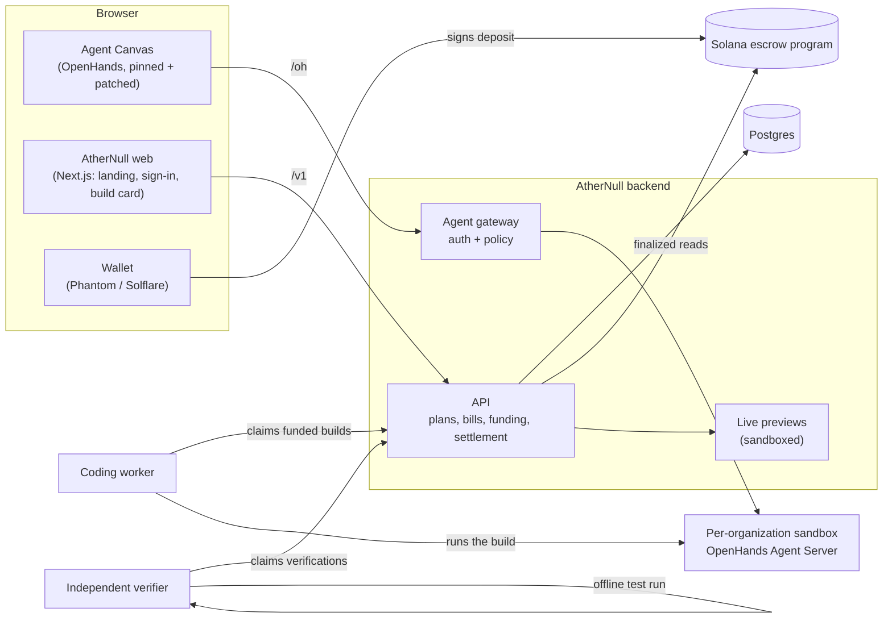

# AtherNull

AtherNull turns a plain-language request into verified, paid-for software. You describe what you want in a chat. An AI agent agrees the scope with you and drafts a plan and a bill. You fund the work into an on-chain escrow, an agent builds it in an isolated workspace, an independent verifier re-runs the tests, and the payment is released only when you accept the result.

**Live demo:** [athernull.io](https://athernull.io), on Solana **devnet** (test funds only; no real money moves).

---

## Contents

- [How it works](#how-it-works)
- [Architecture](#architecture)
- [Built on OpenHands](#built-on-openhands)
- [What AtherNull adds](#what-athernull-adds)
- [Repository layout](#repository-layout)
- [Running locally](#running-locally)
- [Deployment](#deployment)
- [Security model and known limitations](#security-model-and-known-limitations)
- [Documentation](#documentation)
- [Acknowledgements and licensing](#acknowledgements-and-licensing)

---

## How it works

The whole journey happens in one chat.

1. **Describe it.** You start a conversation in the AtherNull canvas, for example *"build me a calculator app"*. A planning agent with no tools asks at most a couple of questions and proposes deliverables and acceptance criteria. It cannot run code, and it never quotes prices.
2. **Plan.** *Draft plan* turns the conversation into a structured, versioned plan: goal, deliverables, acceptance criteria and risks. You approve it, or tell the agent what to change and update it. New ideas get an AtherNull-hosted git repository, so no GitHub account is needed.
3. **Bill and pay.** Approving the plan produces a bill. *Pay now* opens Phantom or Solflare, and the deposit goes into a **project-specific escrow account** on Solana. The backend credits it only after independently checking the **finalized** on-chain transaction.
4. **Build.** A funded build runs as an agent with real tools (terminal, file editor, task tracker) in the organization's sandboxed workspace. You can watch it work live in the canvas.
5. **Verify.** An independent verifier, with its own credentials, checks out the exact commit the agent produced, installs dependencies, and runs the tests **with no network**. It never sees the agent's own claims. Web apps that pass are published as a sandboxed **live preview**.
6. **Accept or reject.** Accepting settles the escrow on-chain and pays out. Rejecting, or a failed build, refunds the deposit. Every payout links to Solana Explorer.

---

## Architecture



| Component | Path | Role |
|---|---|---|
| Web app | `apps/web` | Landing page, sign-up/sign-in, the in-chat build card and panel, Builds page. Next.js. |
| Agent Canvas | `apps/canvas` | The chat workspace. OpenHands Agent Canvas, pinned to an exact upstream commit and changed only through explicit patch files. |
| API | `apps/api` | Fastify + Kysely. Auth (Better Auth, organizations), the agent gateway, plans, budgets, devnet funding and settlement, verification, hosted repositories, live previews. |
| Coding worker | `workers/coding-agent` | Python. Claims funded builds from a Postgres-backed queue (leases, retries) and runs them on the organization's sandbox. |
| Verifier | `services/verifier` | Python. Re-runs the tests on a clean checkout of the exact commit, offline, in a throwaway container. |
| Escrow program | `contracts/solana` | Anchor program: per-project funding accounts bound to the build, settle and refund. |
| Shared packages | `packages/*` | Database schema and migrations, typed contracts and the task state machine, the Solana client, the model router. |

---

## Built on OpenHands

AtherNull uses [OpenHands](https://github.com/OpenHands/OpenHands) as its agent runtime and workspace UI. We took it as a **reference and a dependency, not a fork**: we studied how its pieces fit, kept what is genuinely good at running coding agents, and built the trust, money and verification layer it does not have.

**How we use it**

- **Agent runtime.** Each organization gets its own OpenHands **Agent Server** in a Docker container. Discussions and funded builds run there as conversations. The worker drives it over its REST API, and uses the OpenHands SDK (`openhands-sdk`, `openhands-tools`) for the per-execution adapters.
- **Workspace UI.** The chat, terminal, file and editor views are the OpenHands **Agent Canvas** (`@openhands/agent-canvas` 1.20.0), served under `/canvas`.

**How we keep it maintainable**

- **Pinned, never silently forked.** `apps/canvas/UPSTREAM.json` pins the exact upstream commit (`380fd839`). `apps/canvas/setup.mjs` fetches that commit and applies our changes in order. Upgrading OpenHands means moving the pin and re-checking a small, reviewable set of patches.
- **Every change is an explicit patch** in `apps/canvas/patches/`:

  | Patch | Change |
  |---|---|
  | `0002-require-athernull-session` | The canvas requires an AtherNull session and talks only to AtherNull's gateway |
  | `0003-athernull-chrome` | AtherNull branding and chrome |
  | `0004-athernull-product` | AtherNull catalog, product defaults, OpenHands-platform content hidden |
  | `0005-athernull-apps-platform-managed` | Canvas extensions are managed by AtherNull, not installable by users |
  | `0006-athernull-chat-build-card` | The in-chat build bar and the build panel (plan, bill, payment, progress) |

- **The canvas never talks to an agent directly.** Every request goes through AtherNull's **agent gateway** (`apps/api/src/agent-gateway`). It authenticates the user, enforces a fail-closed policy, injects the sandbox key server-side (the browser never holds it), and applies the **funding gate**: a conversation with tools only runs as part of a funded build.

**How we got there.** Before committing to this design we prototyped two integration approaches (`prototypes/openhands-integration`: a standalone shell, and selective reuse of OpenHands components) and recorded the decisions in ADRs: [0001](docs/adr/0001-openhands-sdk-as-dependency.md) (the SDK as a dependency), [0006](docs/adr/0006-openhands-workspace-frontend.md) (the workspace frontend) and [0015](docs/adr/0015-openhands-agent-canvas-behind-agent-gateway.md) (the canvas behind our gateway).

---

## What AtherNull adds

OpenHands runs agents. AtherNull decides **when an agent may work, what it is paid, and whether its work is accepted**.

| Capability | Where |
|---|---|
| **Discuss before paying.** Conversations start as a tool-less planning agent, capped per organization and per conversation. | `apps/api/src/agent-gateway/discussions.ts` |
| **Funding gate.** Agent work with tools is refused unless the conversation is a funded build that is currently running. | `apps/api/src/routes/agent-gateway.ts` |
| **Structured, versioned plans.** LLM output validated against a schema; prices come from deterministic code, never from the model. | `apps/api/src/planner.ts`, `apps/api/src/pricing` |
| **Provenance chain.** Plan to approval to budget to build is enforced by database constraints and re-checked before a build starts. | `apps/api/src/routes/task-provenance.ts` |
| **On-chain escrow.** Per-project accounts bound to the build by a hash; only finalized transactions are credited; settle and refund on-chain. | `contracts/solana`, `apps/api/src/solana` |
| **Independent verification.** A separate service with its own token re-runs the tests offline on the exact result commit. | `services/verifier` |
| **Commits as the record of work.** AtherNull hosts a git repository per project; each build starts from a pinned commit and returns one commit. | `apps/api/src/repos`, [ADR-0019](docs/adr/0019-commits-as-the-record-of-work.md) |
| **Live previews.** Verified web apps are served at `/preview/<build>/` in a sandboxed, opaque origin. | `apps/api/src/routes/previews.ts` |
| **Sandbox isolation.** Sandboxes get their own network and a host firewall, plus CPU, memory and process limits and a pinned image. | `apps/api/src/sandbox`, `infrastructure/sandbox-network` |

---

## Repository layout

```
apps/
  api/            Fastify API, agent gateway, funding, verification, previews
  web/            Next.js web app (landing, auth, build card, Builds page)
  canvas/         OpenHands Agent Canvas: UPSTREAM.json pin + patches/ + build scripts
workers/
  coding-agent/   Python coding worker (Postgres-backed job queue)
services/
  verifier/       Python independent verifier
contracts/
  solana/         Anchor escrow program and its tests
packages/
  database/       Postgres schema and SQL migrations
  contracts/      Shared types, zod schemas, task state machine
  solana-client/  PDA derivation, binding hash, instruction builders
  model-router/   Cost/complexity model routing
infrastructure/   Dev ingress, sandbox network firewall, VPS service files
docs/             ADRs, architecture, runbooks, security gates
prototypes/       OpenHands integration spikes that informed the design
scripts/dev.mjs   One command for the whole stack
```

---

## Running locally

**Prerequisites:** Node.js 22+, pnpm 9, Docker, Python 3.12, and devnet credentials (a Helius devnet RPC URL and a devnet authority keypair). For payments, a browser with Phantom or Solflare set to **Devnet**.

```bash
pnpm install
python3.12 -m venv workers/coding-agent/.venv
workers/coding-agent/.venv/bin/pip install -e workers/coding-agent   # Windows: .venv\Scripts\pip

node scripts/dev.mjs --init-env   # first run: writes apps/api/.env from your local devnet secrets
pnpm dev                          # Postgres, migrations, canvas build, API, web, ingress, worker, verifier, provisioner
```

Open **http://localhost:8080**, sign up, and start a conversation. In development, verification links are printed to the console when no email provider is configured. Your organization's sandbox is started automatically on first use.

**Tests**

```bash
pnpm -r typecheck
pnpm -r test                                   # API tests need a migrated Postgres (see .github/workflows/ci.yml)
cd workers/coding-agent && pytest && ruff check .
cd services/verifier && pytest && ruff check .
```

Full guide: [docs/runbooks/demo-stack.md](docs/runbooks/demo-stack.md).

---

## Deployment

The reference deployment is a single Ubuntu 24.04 VPS running Coolify:

- **Coolify** builds and serves the web app, and its Traefik proxy routes `/v1`, `/oh`, `/api/auth`, `/canvas`, `/preview` and `/health` to the backend.
- **The backend** (API, canvas, worker, verifier, sandbox provisioner, Postgres) runs on the host as one systemd service, under a dedicated user.
- **Customer sandboxes** run on an isolated Docker network behind host firewall rules. They can reach the public internet but not the host, private networks, other projects on the server, or each other.

Step by step: [docs/runbooks/vps-deploy.md](docs/runbooks/vps-deploy.md). Sandbox network and isolation checks: [docs/runbooks/sandbox-network.md](docs/runbooks/sandbox-network.md).

---

## Security model and known limitations

**What is enforced today**

- The browser never holds sandbox credentials. Every agent request passes the gateway's fail-closed policy.
- Tool-using agent work requires a funded, running build. Discussions are tool-less and rate-capped.
- Funding is credited only from finalized on-chain state, once per transaction signature, with database constraints and immutability triggers guarding money state.
- The verifier has its own credentials and runs tests offline. Customers cannot install canvas extensions.
- Sandboxes are network-isolated from the host and from each other, with resource limits and a pinned image.

**Known limitations**

- **Devnet only.** The escrow currently handles devnet SOL with a fixed demo deposit. USDC escrow, itemized invoices and automatic activation are designed but not yet built.
- **The platform LLM key is reachable inside sandboxes.** The planned fix is an AtherNull model proxy with scoped tokens, so provider keys never leave the backend.
- **Acceptance policy.** The customer can still reject after seeing the work. The escrow design that adds review windows, disputes and an arbiter is documented and not yet implemented.
- **Single host.** All tenants share one VPS. Each organization has its own sandbox container, but builds within one organization share it.

The full assessment and the plan to close these gaps:

- [ATHERNULL_CURRENT_ARCHITECTURE_AUDIT.md](ATHERNULL_CURRENT_ARCHITECTURE_AUDIT.md)
- [docs/security/PRE_LAUNCH_SECURITY_GATES.md](docs/security/PRE_LAUNCH_SECURITY_GATES.md)
- [docs/architecture/CHAT_NATIVE_MIGRATION_PLAN.md](docs/architecture/CHAT_NATIVE_MIGRATION_PLAN.md)

---

## Documentation

| Topic | Document |
|---|---|
| Architecture decisions | [docs/adr/](docs/adr/) |
| Current architecture audit | [ATHERNULL_CURRENT_ARCHITECTURE_AUDIT.md](ATHERNULL_CURRENT_ARCHITECTURE_AUDIT.md) |
| Target design: chat-native USDC escrow | [docs/architecture/CHAT_NATIVE_USDC_ESCROW_TARGET.md](docs/architecture/CHAT_NATIVE_USDC_ESCROW_TARGET.md) |
| Escrow state machine | [docs/architecture/ESCROW_STATE_MACHINE.md](docs/architecture/ESCROW_STATE_MACHINE.md) |
| Chat payment API contract | [docs/architecture/CHAT_PAYMENT_API_CONTRACT.md](docs/architecture/CHAT_PAYMENT_API_CONTRACT.md) |
| Migration plan and phases | [docs/architecture/CHAT_NATIVE_MIGRATION_PLAN.md](docs/architecture/CHAT_NATIVE_MIGRATION_PLAN.md) |
| Security gates | [docs/security/PRE_LAUNCH_SECURITY_GATES.md](docs/security/PRE_LAUNCH_SECURITY_GATES.md) |
| Threat model | [docs/threat-model.md](docs/threat-model.md) |
| Local stack | [docs/runbooks/demo-stack.md](docs/runbooks/demo-stack.md) |
| VPS deployment | [docs/runbooks/vps-deploy.md](docs/runbooks/vps-deploy.md) |

---

## Acknowledgements and licensing

AtherNull's agent runtime and workspace UI are built on **[OpenHands](https://github.com/OpenHands/OpenHands)**, © OpenHands contributors, released under the **MIT License**. The Agent Canvas is fetched from upstream at a pinned commit and modified only through the patches in `apps/canvas/patches/`. The OpenHands license and copyright notice apply to that code.

AtherNull's own code in this repository does not yet carry a license file. Until one is added, all rights are reserved by the AtherNull authors.
