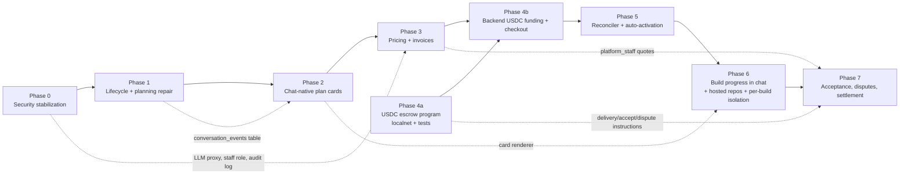

# Chat-native USDC escrow: migration plan

Status: Proposed. Phase 0 is detailed and ready for approval; Phases 1–7 are scoped and get their own detailed plan at each phase boundary.
Related: [CHAT_NATIVE_USDC_ESCROW_TARGET.md](CHAT_NATIVE_USDC_ESCROW_TARGET.md), [ESCROW_STATE_MACHINE.md](ESCROW_STATE_MACHINE.md), [CHAT_PAYMENT_API_CONTRACT.md](CHAT_PAYMENT_API_CONTRACT.md), [../security/PRE_LAUNCH_SECURITY_GATES.md](../security/PRE_LAUNCH_SECURITY_GATES.md).

## 1. Working rules for every phase

1. Inspect the affected code again at the start of the phase. Line numbers drift.
2. Write a scoped plan with the expected file list. Get approval for anything destructive (column drops, data backfills on shared DBs, contract deploys, key rotation).
3. Implement, add tests, run `pnpm -r typecheck`, `pnpm -r test`, Python `pytest`/`ruff`, and Anchor tests when touched.
4. Report failures as they are. Static checks are reported as static, not as runtime verification.
5. Stop at the phase boundary for review.
6. Preserve uncommitted ADR-0019 work and the Apps lock-down. No phase rewrites `repos/`, `repo-transfer.ts` or migration `0020`. They're extended only.
7. New migrations start at **0021**, are additive, and every destructive step (dropping plaintext columns, for example) is a separate, later migration that needs explicit approval.

## 2. Dependency map

- **Critical path:** P0 → P1 → P2 → P3 → P4b → P5 → P6 → P7.
- **Parallel track:** P4a (Anchor program and its adversarial tests) can start right after Phase 0. It's the longest-lead item and needs an external audit before S2.

| Item | Depends on | Unblocks |
|---|---|---|
| Sandbox network isolation + limits | Topology decision (open question 1) | G0, public devnet |
| LLM proxy + scoped tokens | Sandbox can reach exactly the proxy | Removing keys from sandboxes; per-org metering for pricing |
| `platform_staff` role | migration 0021 | Verify override, human quotes, arbiter workflow |
| Audit log writer | none | Every financial phase |
| `discussion_conversations` lifecycle columns + delete sync | Phase 0 audit writer | Phase 2 (cards need a live conversation) |
| `conversation_events` + timeline API | Phase 1 links | Cards (P2), payment status (P4b/P5), build progress (P6) |
| Plan idempotency + revise context + reject | none | Cards (P2), invoices (P3) |
| Rate card + invoices | Plan approval semantics | Funding requirement = invoice total (P4b) |
| `athernull_usdc_escrow` program | none (localnet) | Backend funding (P4b), delivery/dispute (P7) |
| Reconciler + outbox | Invoices, USDC funding | Removing "Activate Build" (P5) |
| Projector into chat | Timeline + execution events | Chat build progress (P6) |
| Hosted repo creation for new ideas | ADR-0019 step 2+ | Planning without a repository (P2, used at P6) |

## 3. Phase 0: security stabilization (detailed, awaiting approval)

### 3.0 Production topology (decided 2026-10-12)

**The production host is an Ubuntu 24.04 VPS running Docker Engine, with Coolify, shared with other projects. That means Option A.**
- Sandboxes run on a dedicated bridge `athernull-sandboxes` (`172.30.0.0/16`; sandboxes in `172.30.128.0/17`; AtherNull platform containers on fixed addresses in `172.30.0.0/24`).
- Host firewall rules sit in `DOCKER-USER` and `INPUT`.
- Sandboxes publish no ports. The API and worker reach them by container name; the host provisioner reaches them by container IP.
- Sandboxes resolve names through public DNS. Docker's embedded DNS forwards from the container namespace, so a private host resolver would otherwise be blocked; the replica test found this.

Details, install steps and evidence are in `docs/runbooks/sandbox-network.md`. Option B (portable) isn't needed.

**Dev (Windows, Docker Desktop):** compose Postgres and Redis are bound to `127.0.0.1`. Dev isolation is still weaker (`host.docker.internal`), so G0.1 is claimed only for the VPS.

### 3.1 Work items and expected file changes

| # | Work item | Files (expected) | Notes |
|---|---|---|---|
| 0.1 | Sandbox network policy (option A or B) | `apps/api/src/sandbox/provision.ts`, `infrastructure/sandbox-network/*` (new), `infrastructure/docker-compose.yml` (bind to 127.0.0.1), `docs/runbooks/sandbox-network.md` (new) | Provisioning fails closed when the policy check fails, except in `NODE_ENV=development` with an explicit flag |
| 0.2 | Resource limits | `provision.ts` | `--memory 4g --memory-swap 4g --cpus 2 --pids-limit 1024 --security-opt no-new-privileges`. `--cap-drop ALL` plus the minimum `--cap-add` set, found by running the agent server's own smoke test (terminal, file edit, git, pip/npm install). Disk: per-org volume size via XFS project quota (Linux) or a documented limitation. Every value is env-configurable with these defaults. |
| 0.3 | Pin the image by digest | `provision.ts` | `SANDBOX_IMAGE` must contain `@sha256:`; the default is the digest of the version the canvas is pinned against (agent-server 1.49.2, `apps/canvas/UPSTREAM.json`). A test asserts the format. |
| 0.4 | LLM proxy | `apps/api/src/routes/llm-proxy.ts` (new), `apps/api/src/llm-tokens.ts` (new), migration `0021_llm_proxy_tokens.sql` | OpenAI-compatible `POST /llm/v1/chat/completions` (streaming). Token = random 32 bytes, stored as a SHA-256 hash, with `organization_id`, `purpose` (`canvas`/`discussion`/`build`), `conversation_id`/`execution_id`, `expires_at`, `revoked_at`, plus daily token caps per org and purpose. Provider keys stay in the API. Usage is written to `usage_events` for builds. Listens on the port the sandbox network allows. |
| 0.5 | Remove keys from all three paths | `provision.ts` (settings + profile use proxy `base_url` + a `canvas` token), `agent-gateway/discussions.ts` (`discussionLlm()` mints a `discussion` token for the conversation), `routes/internal.ts` claim (dispatch carries a `build` token), `workers/coding-agent/.../org_sandbox_adapter.py` (uses the dispatch token; never `require_api_key` for org sandboxes) | Existing sandboxes need re-provisioning to drop the stored key (runbook step, not destructive to volumes) |
| 0.6 | Platform staff role + verify override restriction | migration `0022_platform_staff.sql`, `apps/api/src/session.ts` (`requireStaff`), `routes/jobs.ts` (`/verify` → staff + required `reason`) | Owners get 403. `tenant-authorization.test.ts` and `job-lifecycle.test.ts` updated: existing tests that call `/verify` as owner become staff calls. |
| 0.7 | Audit log writer | `apps/api/src/audit.ts` (new), call sites in jobs, estimates, budget-authorizations, task-provenance, project-funding, provision, policy-sensitive gateway actions; migration `0023_audit_events_append_only.sql` (trigger rejecting UPDATE/DELETE; `actor_user_id`, `request_id` columns) | Written inside the same transaction as the change it records |
| 0.8 | Encrypt sandbox session keys | migration `0024_org_agent_servers_key_enc.sql` (adds `session_api_key_enc`), `apps/api/src/secrets.ts` (AES-256-GCM, `SECRETS_ENCRYPTION_KEY`), `agent-gateway/org-server.ts`, `provision.ts`, a backfill script | The plaintext column is kept until the backfill is verified. Dropping it is a **separate, approval-gated** migration. |
| 0.9 | Verifier install step on the isolated network | `services/verifier/src/verifier/service.py` | Install runs on `athernull-sandboxes` (egress rules apply) instead of `bridge` |
| 0.10 | Isolation test harness | `infrastructure/sandbox-network/isolation-check.sh` (new), `docs/runbooks/sandbox-network.md` | Provisions two test orgs, then from inside sandbox A probes Postgres, API internal routes, metadata, the host gateway and sandbox B (all must fail), plus registry and LLM-proxy reachability (must succeed). Greps for provider key prefixes. Exit code drives G0.1–G0.3. |

| 0.11 | Deployment packaging for Coolify (added 2026-10-12) | `apps/api/Dockerfile`, `workers/coding-agent/Dockerfile`, a Coolify compose file, systemd units for the provisioner and verifier | Nothing but `apps/web` has a Dockerfile today; the API and worker must join `athernull-sandboxes` at fixed platform addresses |

**Progress (2026-10-12):**

| Item | Status |
|---|---|
| 0.1 | **Done, not yet on the VPS.** Network + firewall script, systemd unit, provisioner network mode with the firewall marker check, runbook. Verified in a Docker-in-Docker replica (Docker 27.5, iptables nf_tables): control run 5 leaks, with rules 0 leaks; internet, LLM proxy and platform→sandbox still work. |
| 0.2 | **Done.** Memory/swap, CPUs, pids, no-new-privileges, dropped caps, log rotation; optional gVisor runtime. Disk quota not done (needs XFS project quotas on the VPS; documented). |
| 0.3 | **Done.** Default image pinned by digest; unpinned tags refused unless explicitly allowed. |
| 0.9 | **Done.** Verifier install network and DNS configurable (`VERIFIER_INSTALL_NETWORK`, `VERIFIER_INSTALL_DNS`). |
| 0.10 | **Done.** `isolation-check.sh` (G0.1–G0.3). G0.2 expected to fail until 0.4/0.5. |
| 0.4, 0.5, 0.6, 0.7, 0.8, 0.11 | Not started |

### 3.2 Data and security impact

- **Additive migrations only** (0021–0024).
- No funded data is touched.
- Re-provisioning sandboxes restarts containers but keeps their named volumes, so conversations survive.
- **Breaking for existing deployments:** sandboxes lose direct provider access until the LLM proxy is reachable. Roll out together with re-provisioning (runbook).
- Tests that use `/verify` as an org owner need updating (0.6).

### 3.3 Phase 0 acceptance (maps to G0)

`isolation-check` passes on the target topology. Provider keys can't be found in any sandbox. Owners get 403 on `/verify`. Audit rows are written and can't be modified. The image is pinned by digest. Session keys are encrypted at rest. All existing test suites pass.

### 3.4 Rollback

- Each item is behind its own env flag: `SANDBOX_NETWORK_POLICY`, `LLM_PROXY_ENABLED`, `SANDBOX_LIMITS`.
- The migrations are additive, so reverting code leaves harmless columns and tables.
- Key encryption keeps the plaintext column until a later approved drop.

### 3.5 Estimate

About 6–9 engineer-days: 0.1 (option A) 2d, 0.2–0.3 0.5d, 0.4–0.5 2.5d, 0.6 0.5d, 0.7 1d, 0.8 1d, 0.9–0.10 1d. Option B adds about 2d.

## 4. Proposed migrations (all phases)

| # | Phase | Migration | Contents |
|---|---|---|---|
| 0021 | 0 | `llm_proxy_tokens` | Token hash, org, purpose, bindings, expiry, revocation, caps |
| 0022 | 0 | `platform_staff` | `user_id` PK, `granted_by`, `granted_at`, `roles text[]` (`quote`, `arbiter`, `ops`) |
| 0023 | 0 | `audit_events` hardening | `actor_user_id`, `request_id`; trigger blocking UPDATE/DELETE |
| 0024 | 0 | `org_agent_servers.session_api_key_enc` | Encrypted copy (plaintext dropped later, with approval) |
| 0025 | 1 | Discussion lifecycle + links | `discussion_conversations.archived_at`, `deleted_at`, `project_id` FK; `conversation_projects` is not needed if `project_id` lives on the discussion (decide at Phase 1) |
| 0026 | 1 | Estimate repairs | `REJECTED` status + `rejected_by/at/reason`; `discussion_id` FK; `revision_of` FK; `content_sha256`; `request_idempotency_key` unique `(organization_id, key)`; partial unique index "one non-terminal lineage per discussion"; backfill `discussion_id` from `planned_lineage_id` |
| 0027 | 1 | `api_idempotency_keys` | Org, key, route, request hash, response, TTL |
| 0028 | 2 | `conversation_events` | `id`, monotonic `cursor` (bigserial), `conversation_id` FK, `organization_id`, `type`, `refs jsonb`, `payload jsonb`, `occurred_at`; index `(conversation_id, cursor)` |
| 0029 | 3 | Pricing + invoices | `pricing_rate_cards` (version, JSON config, active flag, unique active); `project_invoices` (status FSM, `estimate_id` unique, `plan_content_sha256`, `currency 'USDC'`, `mint`, `total_base_units bigint`, `terms_version`, `expires_at`, billing entity fields, `rate_card_version`); `project_invoice_line_items`; immutability trigger after ISSUED; `project_budget_authorizations.source` + `'INVOICE'`; `tasks.invoice_id` unique |
| 0030 | 4b | USDC funding columns | `project_funding_accounts`: `asset_type` + `'USDC'`, `mint`, `token_program`, `vault`, `invoice_id` unique, `escrow_program_version`, `funding_deadline`, `work_deadline`; the guard trigger is extended to the new immutable columns; one deposit per USDC account |
| 0031 | 5 | `outbox_events` | `id`, `type`, `aggregate`, `payload`, `available_at`, `attempts`, `locked_by`, `locked_until`, `done_at` |
| 0032 | 6 | Build ↔ conversation projection state | `conversation_event_cursors` per execution (projector checkpoint) |
| 0033 | 7 | Disputes + delivery | `escrow_disputes` (task, reason, opened_by, opened_at, resolution, `release_bps`, resolved_by, signatures); task status `DELIVERED`; `project_funding_settlements.kind` + `'RESOLVE'` |

## 5. Phases 1–7 (scoped; detailed at each boundary)

### Phase 1: data lifecycle and planning repair (about 5–7 days)
- **Delete sync.** Gateway intercepts `DELETE /oh/api/conversations/:id` for discussions:
  - no lineage → soft-delete the row (`deleted_at`), then forward;
  - a lineage with no invoice → archive the row (keep the plan) and forward;
  - an issued invoice, funding or a task → **refuse with 409** ("This conversation has a funded project; archive it instead"). Archiving hides it in the canvas list through a gateway-filtered list.
  - A failed upstream delete rolls back the soft-delete.
- **Reconciliation script** for existing orphans: rows whose sandbox conversation returns 404 get `deleted_at` (dry-run by default).
- `listDiscussions` excludes deleted and archived rows. Titles are cached on the row instead of one sandbox call per row (fixes B7). React Query invalidates `["discussions"]` and `["builds"]` after these actions.
- **Idempotent planning** (0026/0027 + transaction-scoped advisory lock on `discussion_id`).
- **Revise with context:** a planner input builder takes the original requirements, previous `planner_output`, the change request and constraints. Tests assert that all of them reach the prompt.
- **Reject** endpoint and state.
- Gate: G1.3, G1.4; regression tests for B1–B3.

### Phase 2: chat-native plan cards (about 7–10 days)
- `conversation_events` + timeline API and SSE.
- Canvas patch `0006-athernull-chat-cards.patch`: the composer gets **Draft plan**; a card renderer merges timeline events into the chat by `occurredAt`; Plan card actions (Approve / Reject / Add more inline).
- The plan card shows quote or `pricingStatus`.
- No repository needed: plans attach to a lazily created hosted project.
- Builds page unchanged (compatibility).
- Gate: G1.1, G1.2, G1.5; request → revise → reject → approve, entirely in chat, survives a refresh.

### Phase 3: pricing and invoices (about 5–7 days)
- Rate card in the DB (`pricing_rate_cards`).
- `priceEstimate` takes effort, model allowance, verification, an optional infrastructure item, margin and contingency, and produces line items.
- Unpriceable or out-of-bounds plans go to `REVIEW_REQUIRED` and the staff quote endpoint.
- Approval issues the invoice, budget authorization, task and funding row in one transaction.
- Invoice card in chat.
- Gate: G2.3 (DB part).

### Phase 4a: USDC escrow program (about 10–15 days, parallel)
- New program `athernull_usdc_escrow` in `contracts/solana/programs/`, with a separate program id, implementing ESCROW_STATE_MACHINE §2–3.
- `packages/solana-client` gets the new IDL, PDA/binding helpers and instruction builders (the existing SOL helpers stay).
- Adversarial localnet suite (G2.1).
- No devnet deploy without approval; no mainnet.

### Phase 4b: backend funding and chat checkout (about 6–8 days)
- `apps/api/src/solana/usdc-funding-service.ts` beside the SOL service, reusing the patterns: finalized-only, `transfer_checked` parsing, mint/program allowlist, exact amount, unique signature, chain/DB consistency.
- Payment endpoints (API contract §4).
- Pay now card in chat, reusing the Wallet Standard provider from `project-funding-panel.tsx`.
- `/fund` keeps serving legacy SOL.

### Phase 5: reconciler and auto-activation (about 5–7 days)
- `apps/api/scripts/payment-reconciler.ts` (or an in-process job behind `RECONCILER_ENABLED`) + outbox dispatcher + consistency checker.
- Auto-activation inside the crediting transaction, with the provenance check re-run.
- "Activate Build" is removed for USDC tasks only after the restart and kill-the-browser integration tests pass (G2.4, G2.8).

### Phase 6: build progress in the original chat (about 8–12 days)
- Projector from `execution_events`, task transitions and verifier results to `conversation_events`.
- Milestones mapped from the plan's implementation steps (best effort, labelled as such).
- Hosted repository created at funding for new ideas (ADR-0019 `createRepo` route); existing-repo validation before dispatch.
- Per-build isolation: per-build working directory owned by a build user, customer terminal read-only on builds (or per-build containers if the agent server allows). Decided at the start of the phase.
- Gate: G3.4.

### Phase 7: acceptance, disputes, settlement (about 6–9 days, plus counsel review)
- Operator `record_delivery` after verifier PASS.
- Preview-only artifact access before release.
- Accept and dispute transactions signed in chat.
- Review-window release job; arbiter resolution flow for staff.
- Escrow agreement document plus `terms_version` on invoices.
- Legacy SOL wind-down report.
- Gate: G3.1–G3.3.

**Total:** about 58–84 engineer-days, plus the external audit and counsel review, which are calendar-bound rather than effort-bound.

## 6. Test plan (cross-phase)

| Area | Where | Key cases |
|---|---|---|
| Planning | `apps/api/test/estimates-lifecycle.test.ts`, `planner.test.ts` (extended), new `chat-plans.test.ts` | Structured plan; revise keeps context; superseded can't be approved; reject gives no invoice; 10 parallel drafts give one lineage |
| Lifecycle | new `discussion-lifecycle.test.ts` | Each deletion scenario in Phase 1; funded conversation refuses delete; orphan reconciliation dry-run |
| Billing | new `invoices.test.ts` | Invoice equals the approved version; line-item math; immutable after issue; cross-org 404; member can't approve |
| Payments | `fake-chain.ts` extended for SPL; new `usdc-funding.test.ts` | Every row of ESCROW_STATE_MACHINE §7; replayed signature; RPC failure then recovery; finalized-only |
| Contract | `contracts/solana/tests/usdc_escrow_*.ts` | G2.1 list |
| Activation | new `auto-activation.test.ts` | Funded gives exactly one QUEUED; unfunded gives none; restart mid-transaction; duplicate reconciler runs |
| Build | worker `pytest`, `job-lifecycle.test.ts` | Worker crash recovery (existing); build stays linked to the conversation; verifier result can't be forged by owner |
| Settlement | new `usdc-settlement.test.ts` | Accept, release after window, dispute and resolve, duplicate release refused, state survives restart |
| Isolation | `apps/api/scripts/isolation-check.ts` | G0.1–G0.3 |
| Wallets | Manual test script (Phantom, Solflare on devnet), recorded in `docs/runbooks/` | Connect, review, sign, close tab, return |

## 7. Rollback strategy

- **Feature flags per phase:** `CHAT_CARDS_ENABLED`, `INVOICES_ENABLED`, `USDC_FUNDING_ENABLED`, `AUTO_ACTIVATION_ENABLED`, `CHAT_BUILD_PROGRESS_ENABLED`. With a flag off, the current Builds-page flow keeps working.
- **Migrations are additive.** The destructive cleanups (plaintext key column, legacy SOL paths) are separate, later and approval-gated.
- **On-chain:** the new program is separate, so rolling back the backend never strands SOL obligations. If the USDC flag is turned off after deposits exist, the reconciler, release, refund and reclaim paths **stay on** until every USDC escrow is terminal.
