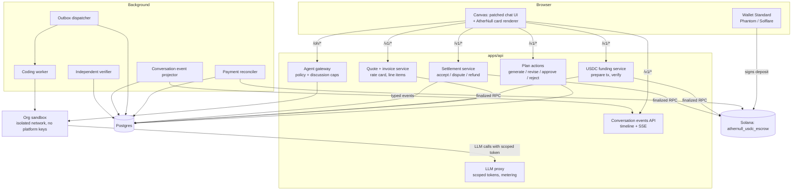
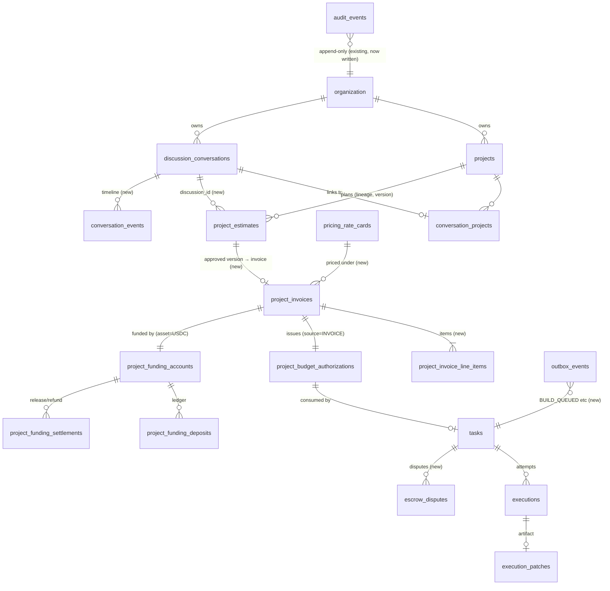

# Chat-native USDC escrow: target architecture

Status: Proposed (planning only; nothing here is implemented yet)
Date: 2026-10-12
Inputs: `ATHERNULL_CURRENT_ARCHITECTURE_AUDIT.md` (re-validated against the working tree on 2026-10-12, section 1 below), `docs/threat-model.md`, ADR-0009, 0013, 0014, 0015, 0016, 0017, 0019.
Companion documents: [CHAT_NATIVE_MIGRATION_PLAN.md](CHAT_NATIVE_MIGRATION_PLAN.md), [ESCROW_STATE_MACHINE.md](ESCROW_STATE_MACHINE.md), [CHAT_PAYMENT_API_CONTRACT.md](CHAT_PAYMENT_API_CONTRACT.md), [../security/PRE_LAUNCH_SECURITY_GATES.md](../security/PRE_LAUNCH_SECURITY_GATES.md).

## 1. Baseline validation (audit vs. current checkout)

I re-checked the audit against the working tree. It holds, with these additions and corrections:

| # | Item | Status |
|---|---|---|
| V1 | All file paths, tables, status values and authorization rules named in the audit are present as described. | Confirmed |
| V2 | Uncommitted work: ADR-0019 hosted repositories (`apps/api/src/repos/`, `routes/repo-transfer.ts`, migration `0020`, worker and verifier changes); Apps lock-down (`policy.ts`, `patches/0005`). It must be preserved. | Confirmed |
| V3 | **New:** in the deployed SOL program, the **platform authority alone** can `settle_project_funding` (any `release_amount ≤ deposited`) or `refund_project_funding` at any time. Project funding has **no on-chain timeout**, so the customer has no on-chain recourse if the platform disappears (`contracts/solana/programs/athernull_escrow/src/instructions/project_funding.rs`). | Confirmed |
| V4 | **Correction:** the platform LLM key enters customer sandboxes by **three** paths, not one: sandbox settings at provisioning (`sandbox/provision.ts:122-131`); the discussion request body (`agent-gateway/discussions.ts:29-36`, `api_key` in the conversation request); and the build request body (`workers/coding-agent/.../org_sandbox_adapter.py:376-385`). | Confirmed |
| V5 | **New:** the verifier's dependency install step runs with `--network bridge` (default bridge), before the no-network test step (`services/verifier/src/verifier/service.py:127-135`). It is resource-limited (2 GB, 2 CPU, 512 pids). | Confirmed |
| V6 | **New:** `docs/threat-model.md` requires "default-deny outbound" for sandboxes and "no prod DB creds" for agents. The org sandbox implementation does not meet the first. | Confirmed |
| V7 | There is no platform-staff role. Only org roles exist (owner/admin/member, `session.ts:97-126`), so "admin-only override" currently means "any customer who owns an org". | Confirmed |
| V8 | The legacy escrow instructions (`initialize_escrow`, `fund_escrow`, …) are referenced only by `packages/solana-client/src/legacy-escrow.ts` and its IDL; no API path uses them. | Confirmed |
| V9 | `Anchor.toml` declares only `localnet`. The devnet program id comes from `SOLANA_FUNDING_PROGRAM_ID`; whether it equals the declared id is Unknown (the value wasn't read). | Unknown |
| V10 | The production deployment topology is still absent from the repository. Phase 0 cannot rule host-network reachability in or out for production. | Blocker (question to the team) |

## 2. Customer journey (target)

```
Original conversation (canvas)
  1 customer describes the idea ── discussion agent (no tools) asks questions
  2 customer clicks "Draft plan" (or the agent suggests it) ── backend planner → PLAN card v1
  3 [Approve] [Reject] [Add more]   ── Add more → PLAN card v2 (context kept)
  4 Approve → backend quote → INVOICE card (itemized USDC, expiry)
  5 [Pay now] → Phantom/Solflare → sign deposit into the project escrow vault
  6 PAYMENT card: pending → finalized (backend reconciler, browser not needed)
  7 BUILD cards: queued → started → milestones → verification passed/failed
  8 DELIVERY card: preview + review window → [Accept] / [Report a problem]
  9 SETTLEMENT card: released to AtherNull / refunded / in dispute
```

The Builds page stays as a secondary list and admin view. No step requires it.

## 3. Components and responsibilities



| Component | New / reused | Notes |
|---|---|---|
| Discussion agent | Reused | Stays tool-less. It may *suggest* drafting a plan; it can't trigger one. |
| Planner (`planner.ts`) | Reused, extended | Input becomes a structured context: original requirements, previous plan, the change request, constraints. |
| Estimates and lineages | Reused, extended | Adds `REJECTED`, `discussion_id`, an idempotency key, and a content hash of the approved version. |
| Pricing engine | Reused, extended | Rate card moves from `rates.ts` constants into versioned DB rows. Unpriceable plans go to `REVIEW_REQUIRED` (human quote). |
| Budget authorization | Reused | The invoice issues the authorization (`source = 'INVOICE'`), so the existing provenance chain is unchanged. |
| Task provenance | Reused unchanged | `assertTaskProvenanceChain` still guards every activation. |
| Invoices | **New** | `project_invoices` and `project_invoice_line_items`; immutable once issued. |
| USDC escrow program | **New program** | `athernull_usdc_escrow`, a separate program id. The SOL program is frozen for new obligations and wound down (section 6). |
| Funding service | Extended | SPL token parsing, mint and token-program allowlist, exact-amount policy. |
| Payment reconciler | **New** | Background loop that discovers and credits deposits and auto-activates through the outbox. |
| Outbox | **New** | `outbox_events`, dispatched with `FOR UPDATE SKIP LOCKED`. |
| Conversation events | **New** | `conversation_events` table, the read API, and the canvas card renderer (canvas patch). |
| Coding worker / verifier | Reused | The verifier becomes the only source of truth for PASS/FAIL. The manual override is removed from customers. |
| LLM proxy | **New** | OpenAI-compatible endpoint in `apps/api` that sandboxes call with per-org, per-purpose tokens. |
| Platform staff role | **New** | `platform_staff` (DB table plus check) for dispute resolution and human quotes. Separate from org owner. |

## 4. Key decisions

**D1. Card UI is AtherNull-owned, not LLM messages.**
- Cards live in a Postgres `conversation_events` table keyed by the discussion's conversation id.
- The canvas gets one patch, `0006`, that merges these events into the chat timeline by timestamp and renders typed cards with buttons. The buttons call `/v1` endpoints with the exact plan id, version and invoice id.
- Nothing is injected into the OpenHands conversation that the LLM could read and imitate.
- *Why:* the backend stays authoritative for money, cards replay after a refresh, the chat stream doesn't change, and the patch is small and isolated.
- *Alternative rejected:* posting cards as agent messages. The LLM would see them, could hallucinate look-alikes, and buttons can't be bound to authoritative ids.

**D2. "Draft plan" is a user action, not an LLM decision.**
- The composer gets a **Draft plan** control. The discussion agent can recommend it in plain text.
- The backend decides nothing financial from model output. The planner produces effort only; the price comes from the rate card.

**D3. A new USDC escrow program; the SOL program stays as is.**
- The account layout, CPI surface (SPL Token / Token-2022 checks, vault ATA) and authority model all change. Upgrading in place would put live SOL obligations and the new token logic under one upgrade authority and one audit.
- Any SOL obligations that exist are wound down under the current backend rules (migration plan, section 6).

**D4. The escrow balances authority between the parties (details in ESCROW_STATE_MACHINE.md).**
- The operator key can't release funds before delivery is recorded on-chain.
- After delivery, release needs either the customer's acceptance signature, or the review window to have expired with no dispute.
- Refunds before delivery are allowed for the operator, and for the customer after the work deadline.
- Disputes are resolved by a separate **arbiter** key (platform staff multisig), never by the operator hot key.
- This removes both "customer refunds after delivery" and "platform seizes funds at will".

**D5. One exact deposit per invoice.**
- The contract accepts exactly one deposit, of exactly `required_amount`, in the allowlisted mint, while the state is `AwaitingFunds` and before `funding_deadline`.
- Partial, overpaid, late or second deposits fail on-chain, so the funds never move.
- Tokens transferred directly to the vault outside the instruction are never credited. They go back to the customer when the vault is closed.

**D6. Exactly one build per invoice, activated by the backend.**
- Issuing an invoice creates the budget authorization and the task (`AWAITING_FUNDING`) in one transaction, using the existing provenance code. Unique constraints: `invoice → task`, `invoice → funding account`.
- The reconciler credits a finalized deposit. In the same DB transaction it re-runs the provenance check, moves the task `AWAITING_FUNDING → QUEUED`, and writes `BUILD_QUEUED` to the outbox.
- There is no customer "Activate" button.

**D7. Sandboxes stop holding platform credentials.**
- Every LLM call from a sandbox goes through the AtherNull LLM proxy, using a token scoped to the org and purpose (`discussion`, `build:<executionId>`, `canvas`).
- Tokens are revocable, rate-limited and metered. Provider keys stay in the API process.

**D8. Customer roles don't decide verification.**
- `POST /v1/jobs/:id/verify` is limited to platform staff, for incident recovery, and every use writes an audit event.
- The customer's levers are **Accept** and **Report a problem** (opens a dispute). After delivery, neither one is "refund me".

**D9. Hosted repositories by default.**
- A new idea gets a hosted repository (ADR-0019 `createRepo`) once funding is finalized.
- An existing GitHub repository is optional and validated before execution.
- The planner no longer needs a repository.

## 5. Data model (proposed additions)



Changes to existing tables:
- `discussion_conversations` gains `archived_at`, `deleted_at` and `project_id` (FK, nullable).
- `project_estimates` gains `discussion_id` (FK), `REJECTED` status, `rejected_by`/`rejected_at`/`rejection_reason`, `revision_of` (FK to the previous version), `content_sha256` and a `request_idempotency_key` (unique per org).
- `project_budget_authorizations.source` adds `'INVOICE'`.
- `project_funding_accounts` adds `asset_type 'USDC'`, `mint`, `token_program`, `vault`, `invoice_id` (unique), `escrow_program_version`, `funding_deadline`.
- `tasks` adds `invoice_id` (unique).

The exact DDL is in the migration plan, section 4.

## 6. Non-goals (this program of work)

- Mainnet deployment, live funds, fiat on-ramps, taxes in more than one jurisdiction.
- Deploying the customer's application (no deploy integration exists today).
- Replacing the OpenHands canvas or the Agent Server.
- Per-build containers in Phase 0. That's Phase 6; Phase 0 isolates per org and adds limits.

## 7. Open questions for the team

1. **Production topology** (V10): same host for API, worker and sandboxes? Coolify? This decides the Phase 0 network design.
2. **Billing entity and tax:** which legal entity issues invoices; is any tax collected? The invoice schema reserves fields, but the policy is a business decision.
3. **Review window and dispute SLA:** proposed defaults of 72 h review and 7 d dispute resolution need sign-off.
4. **Preview before acceptance:** diff and test report only (proposed), or a full download?
5. **Arbiter key custody:** who holds the arbiter multisig (proposed 2-of-3 platform staff)?
6. **USDC mint for devnet:** Circle's devnet USDC, or a self-issued test mint for CI? Proposed: a self-issued mint in localnet CI, Circle devnet USDC on devnet.
