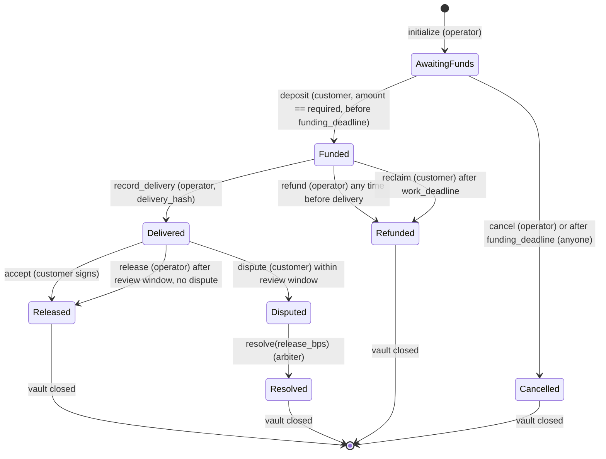
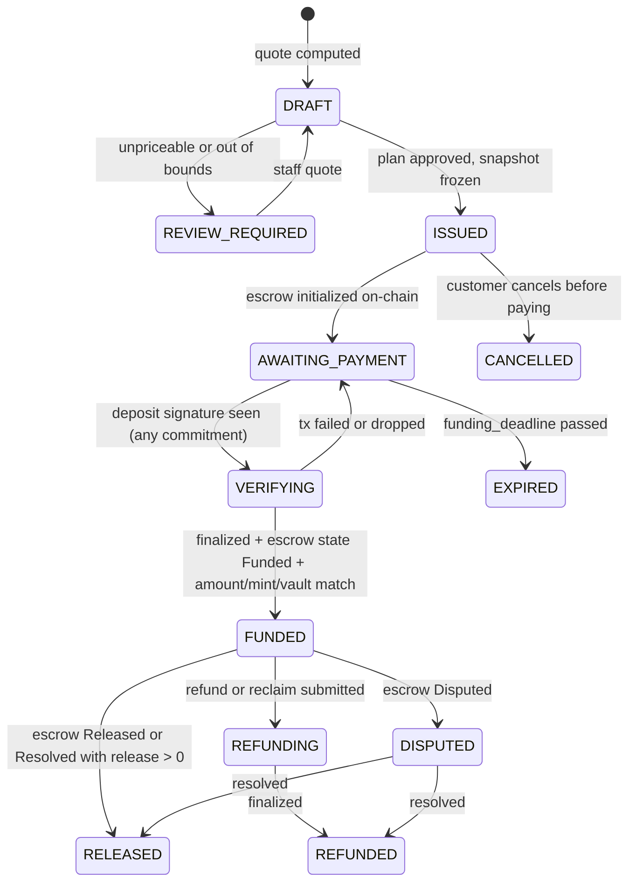

# Escrow state machine: USDC project escrow

Status: Proposed. Design input for the new `athernull_usdc_escrow` program, the backend funding service and the escrow agreement. Nothing is deployed.
Related: [CHAT_NATIVE_USDC_ESCROW_TARGET.md](CHAT_NATIVE_USDC_ESCROW_TARGET.md) decisions D3–D6 and D8.

Three state machines have to agree with each other:

1. **On-chain escrow account** (the program). This is the only thing that can move tokens.
2. **Invoice** (backend). This is what the customer agreed to pay.
3. **Task** (backend; the existing FSM in `packages/contracts/src/tasks.ts`, extended). This is the work.

## 1. Parties and keys

| Party | Key | Can do |
|---|---|---|
| Customer | Their wallet (Phantom / Solflare) | Deposit; accept delivery; open a dispute; reclaim funds after the work deadline if nothing was delivered |
| Operator | Platform hot key in `apps/api` (KMS-backed in production) | Initialize escrow; record delivery; refund **before** delivery; release **after** the customer accepts or the review window expires |
| Arbiter | Separate multisig of platform staff (proposed 2-of-3) | Resolve a dispute with any split between release and refund |
| Program | PDA `["escrow", binding_hash]`; vault = ATA(PDA, mint) | Holds tokens; enforces every rule below |

None of the coding worker, the verifier, the discussion agent or a sandbox holds any of these keys (`docs/threat-model.md`).

## 2. On-chain account

```
UsdcEscrow (PDA seeds: ["escrow", binding_hash])
  version: u8
  binding_hash: [u8;32]      sha256("athernull:usdc-escrow:v1" | org | project | invoice | task | amount | mint)
  customer: Pubkey
  operator: Pubkey
  arbiter: Pubkey
  mint: Pubkey               must be in the program's allowlist (config PDA)
  token_program: Pubkey      SPL Token (classic) only in v1; Token-2022 rejected
  vault: Pubkey              ATA(escrow PDA, mint), created at initialize
  required_amount: u64       exact base units (USDC: 6 decimals)
  funding_deadline: i64      invoice expiry
  work_deadline: i64         after this, an undelivered escrow can be reclaimed by the customer
  review_window_secs: i64    from delivered_at
  delivery_hash: [u8;32]     sha256 of the delivered result (commit id + patch sha256)
  delivered_at: i64
  state: EscrowState
  release_amount / refund_amount: u64   set at close
  bump: u8
Config PDA ["config"]: admin (upgrade multisig), allowed_mints[], paused: bool
```

## 3. On-chain states and instructions



| Instruction | Signer | Preconditions (all checked on-chain) | Effect |
|---|---|---|---|
| `initialize` | operator | Config not paused; mint allowed; token program == SPL Token; `required_amount > 0`; deadlines ordered (`now < funding_deadline < work_deadline`); PDA doesn't exist | Creates the escrow and vault ATA (owned by the PDA) |
| `deposit(amount)` | customer | `state == AwaitingFunds`; `now ≤ funding_deadline`; `amount == required_amount`; source token account owner == customer and mint == escrow.mint; vault == escrow.vault | `transfer_checked` (decimals) customer → vault; `state = Funded` |
| `record_delivery(hash)` | operator | `state == Funded`; `hash != 0` | `state = Delivered`; `delivered_at = now` |
| `accept` | customer | `state == Delivered` | Releases the full amount to the treasury ATA; closes the vault |
| `release` | operator | `state == Delivered`; `now ≥ delivered_at + review_window` | Same as accept |
| `dispute` | customer | `state == Delivered`; `now < delivered_at + review_window` | `state = Disputed` |
| `resolve(release_bps)` | arbiter | `state == Disputed`; `release_bps ≤ 10000` | Splits with checked math: release → treasury, remainder → customer; closes |
| `refund` | operator | `state == Funded` (before delivery) | Everything back to the customer; closes |
| `reclaim` | customer | `state == Funded`; `now > work_deadline` | Everything back to the customer; closes |
| `cancel` | operator, or anyone after `funding_deadline` | `state == AwaitingFunds` | Closes the empty escrow; any stray vault tokens go to the customer |

**Account-substitution defences, on every instruction:**
- PDA re-derived from `binding_hash`.
- `has_one` checks for customer, operator, arbiter, mint and vault.
- `token::mint` and `token::authority` constraints on the vault.
- Destination ATAs derived (treasury from config, customer from `escrow.customer`), never taken from caller input.
- `token_program` constrained to the stored program.

**Single consumption:** every closing instruction requires a non-terminal state and closes the account. A replay fails because the account no longer exists.

**Stray tokens:** a direct SPL transfer into the vault isn't credited, because `state` didn't change. At close, the program transfers `vault.amount − released` to the customer. The closing instruction does the arithmetic on the actual vault balance, with checked math.

**Emergency controls:**
- `pause` (config admin multisig) blocks `initialize` and `deposit` only. It never blocks `reclaim`, `refund` or `accept`, so customers can always exit.
- The upgrade authority is the admin multisig. It's documented, and it should be time-locked before mainnet.

## 4. Invoice states (backend)



Rules:
- **Issued snapshots are immutable**: line items, total, mint, plan version and content hash. A DB trigger enforces this, following the `project_funding_accounts_guard` pattern.
- `FUNDED` means held in escrow. Money that has reached AtherNull is `RELEASED`. There's no single `PAID` flag.
- `EXPIRED` and `CANCELLED` are terminal. The linked task moves to `CANCELLED` in the same transaction.

## 5. Task FSM changes

Additions to `TASK_TRANSITIONS` (existing transitions are kept):

| From | To | Trigger |
|---|---|---|
| `AWAITING_FUNDING` | `QUEUED` | Reconciler, in the funding transaction. Today this goes `FUNDED → QUEUED` in one request; keep `FUNDED` as an internal hop so the assertion table stays valid. |
| `AWAITING_FUNDING` | `CANCELLED` | Invoice expired or cancelled (already legal) |
| `AWAITING_ACCEPTANCE` | `DELIVERED` (new) | Operator `record_delivery` finalized |
| `DELIVERED` | `ACCEPTED` | Customer `accept`, or the review window expired and the operator `release` was finalized |
| `DELIVERED` | `DISPUTED` | Customer `dispute` finalized (state already exists) |
| `DISPUTED` | `SETTLING` / `REFUNDING` | Arbiter `resolve` (already legal) |
| `VERIFYING` | `FAILED` | **Verifier only** (the customer path is removed) |
| `FAILED` (attempts exhausted) | `REFUNDING` | Operator refund (before delivery, so legal on-chain) |
| `AWAITING_ACCEPTANCE` | `REJECTED` | **Removed for USDC escrows.** Rejection after verification becomes a dispute. It stays for legacy SOL tasks. |

## 6. Delivery policy (escrow agreement summary)

| Topic | Proposed rule (needs business sign-off) |
|---|---|
| Successful delivery | Independent verifier PASS on the exact result commit, **and** every acceptance criterion maps to a passing test or a recorded verifier check |
| Before acceptance | **Preview only**: diff, file list, verifier report. The full hosted repository and download unlock at `RELEASED`. Live sandbox files during the build: build directories become read-only to the customer's terminal (Phase 6), and for Phase 1–5 the preview risk is accepted as documented. |
| Review window | 72 h after `record_delivery`. Accept, or dispute with a reason. Silence means release. |
| Remediation | A dispute can be answered with one free remediation build (same invoice, new execution) before arbitration |
| Refund eligibility | Full refund if the build fails verification after its attempts, or nothing is delivered by `work_deadline`. Partial or full by arbiter decision in a dispute. Never a customer-only refund after delivery. |
| Abandoned (platform) | Customer `reclaim` after `work_deadline` (proposed: 7 d after funding for v1 sizes) |
| Abandoned (customer) | The review window expires and release happens |
| Fees | Shown as invoice line items; released together with the work amount |

## 7. Partial, over, late and unrelated deposits

| Case | On-chain | Backend |
|---|---|---|
| Partial (`amount < required`) | `deposit` fails (`AmountMismatch`); tokens don't move | Nothing credited |
| Overpaid (`amount > required`) | Fails, same as above | Nothing credited |
| Second deposit | Fails (`state != AwaitingFunds`) | Ledger unique per escrow (`one_deposit_per_funding_account`) |
| Late (after `funding_deadline`) | Fails (`FundingClosed`) | Invoice `EXPIRED`; customer must re-approve, giving a new invoice and a new escrow |
| Direct SPL transfer to the vault | Not credited; returned to the customer at close | Reconciler flags `STRAY_TOKENS` in the audit log and alerts |
| Wrong mint / token program / Token-2022 | Fails on constraints | Never credited |

## 8. Legacy SOL obligations

- From the USDC go-live flag onward, new funding accounts are USDC only.
- Existing devnet SOL accounts keep their current backend rules (accept, reject, refund) until terminal.
- A staff-only report lists any that aren't terminal.
- The SOL program's `ProjectFunding` path is then marked deprecated. There's no in-place migration of funds.
